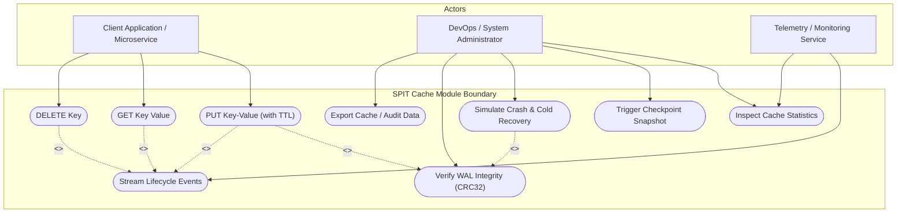
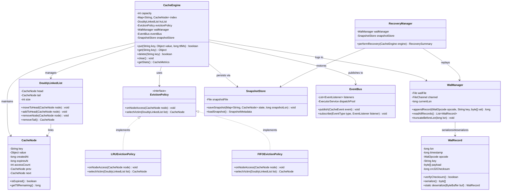
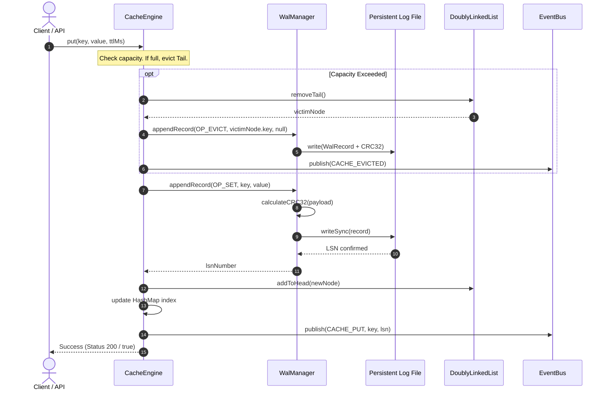
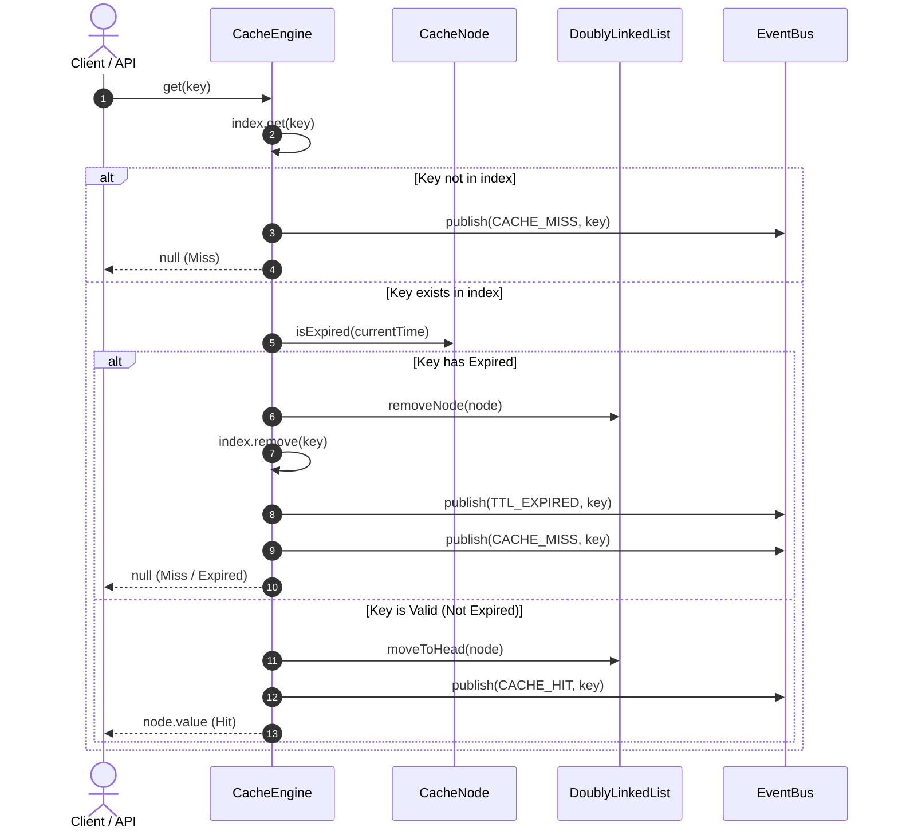
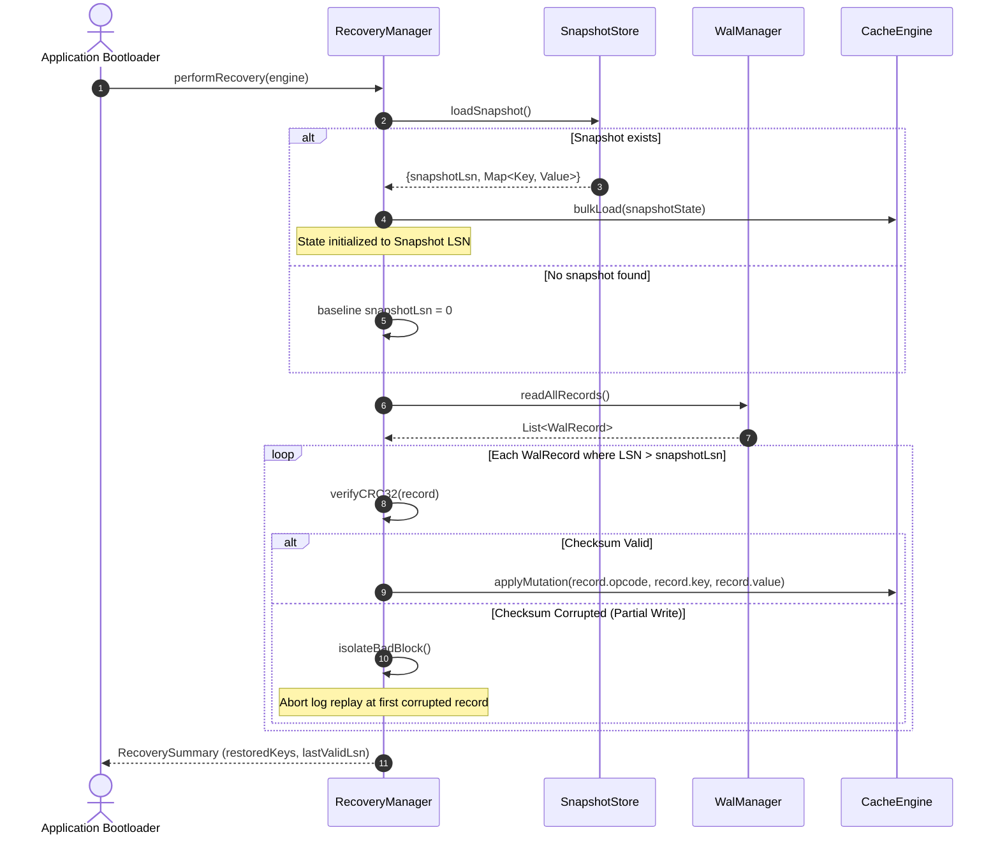
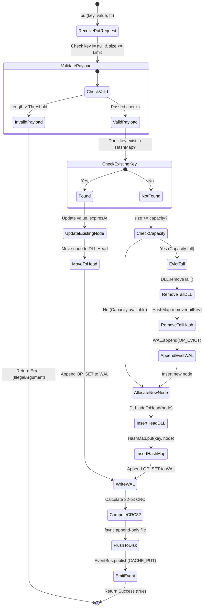
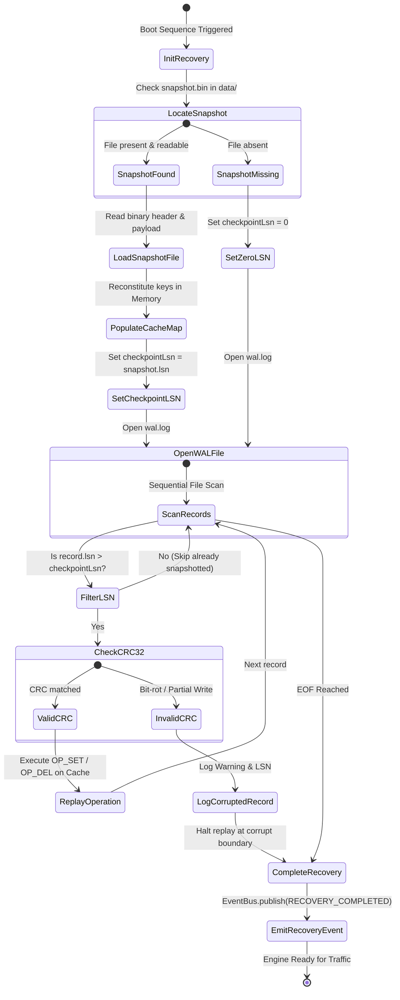
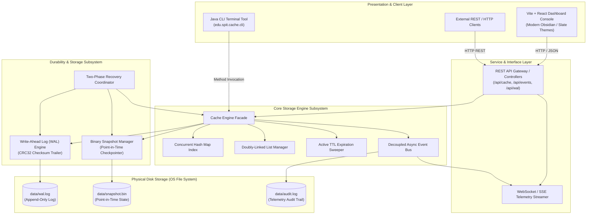

# SPIT Cache Module — UML Architecture & Design Specifications
## Object-Oriented Modeling & System Schematics
**Institution:** Sardar Patel Institute of Technology (SPIT), Mumbai  
**Department:** Computer Science and Engineering  
**Academic Year:** 2026–27 | **Semester:** V | **Subject:** Mini Project (PR1)  
**Evaluation Category:** Phase 2: Architecture & Design (P2 — UML Diagrams: 5 Marks)  

---

## Table of Contents
1. [Overview of System Modeling](#1-overview-of-system-modeling)
2. [Use Case Diagram & Actor Specifications](#2-use-case-diagram--actor-specifications)
3. [Class Diagram (Core Domain Model)](#3-class-diagram-core-domain-model)
4. [Sequence Diagrams (Runtime Interaction Flows)](#4-sequence-diagrams-runtime-interaction-flows)
   - 4.1 Cache Write & WAL Append Sequence
   - 4.2 Cache Read with TTL Expiry Check Sequence
   - 4.3 Cold Start Crash Recovery Sequence
5. [Activity Diagrams (Process Logic & Control Flow)](#5-activity-diagrams-process-logic--control-flow)
   - 5.1 Cache Insertion & Eviction Pipeline
   - 5.2 Two-Phase Recovery Workflow
6. [Component Diagram (Subsystem Physical Topology)](#6-component-diagram-subsystem-physical-topology)
7. [Design Patterns Employed](#7-design-patterns-employed)

---

## 1. Overview of System Modeling
The unified modeling for the **SPIT Cache Module** illustrates both structural static topologies (classes, components, modules) and dynamic behavioral flows (state transitions, sequence messages, and activity pipelines). All models reflect the actual codebase structure implementing Write-Ahead Logging (WAL), $O(1)$ Hash-Doubly-Linked List Cache Engine, Event Bus subscribers, and Recovery subsystems.

---

## 2. Use Case Diagram & Actor Specifications

### Diagram

### Actor Description
1. **Client Application**: Consumes high-speed cache APIs (`PUT`, `GET`, `DELETE`) to offload primary storage.
2. **DevOps / Administrator**: Interacts with the visual telemetry console to monitor hit/miss ratios, inspect byte-level WAL records, manage backups, and trigger crash recovery simulations.
3. **Telemetry Consumer**: Subscribes to the asynchronous event pipeline to capture system diagnostics and metrics without impacting core cache throughput.

---

## 3. Class Diagram (Core Domain Model)

### Class Responsibility & Relationships
- **`CacheEngine`**: Facade and coordinator for in-memory operations, thread coordination, and storage subcomponents.
- **`DoublyLinkedList` & `CacheNode`**: Maintains $O(1)$ node insertion, removal, and head repositioning.
- **`EvictionPolicy` (Strategy Pattern)**: Decouples eviction decision logic from the core cache engine.
- **`WalManager`**: Handles append-only disk logging with byte-level CRC32 trailer serialization.
- **`RecoveryManager`**: Orchestrates two-phase crash reconstitution (Snapshot load followed by log replay).
- **`EventBus` (Observer Pattern)**: Dispatches non-blocking lifecycle notifications to telemetry consumers.

---

## 4. Sequence Diagrams (Runtime Interaction Flows)

### 4.1 Cache Write & WAL Append Sequence

---

### 4.2 Cache Read with TTL Expiry Check Sequence

---

### 4.3 Cold Start Crash Recovery Sequence

---

## 5. Activity Diagrams (Process Logic & Control Flow)

### 5.1 Cache Insertion & Eviction Pipeline

---

### 5.2 Two-Phase Recovery Workflow

---

## 6. Component Diagram (Subsystem Physical Topology)

---

## 7. Design Patterns Employed
1. **Facade Pattern**: `CacheEngine` provides a unified, simple programmatic interface hiding internal complexities of hash indexing, doubly-linked list node splicing, WAL serialization, and event dispatching.
2. **Strategy Pattern**: `EvictionPolicy` defines an abstract interface implemented by `LRUEvictionPolicy`, `FIFOEvictionPolicy`, and `LFUEvictionPolicy`, allowing dynamic runtime swapping.
3. **Observer Pattern**: `EventBus` facilitates loose coupling between the high-throughput cache execution path and downstream telemetry consumers (metrics aggregator, audit logger, dashboard SSE emitter).
4. **Memento Pattern**: `SnapshotStore` captures and externalizes the cache's internal state without violating encapsulation, allowing restoration to a point-in-time state.
5. **Chain of Responsibility**: Handlers in the write pipeline (Validation $\rightarrow$ WAL serialization $\rightarrow$ In-memory update $\rightarrow$ Event notification).
