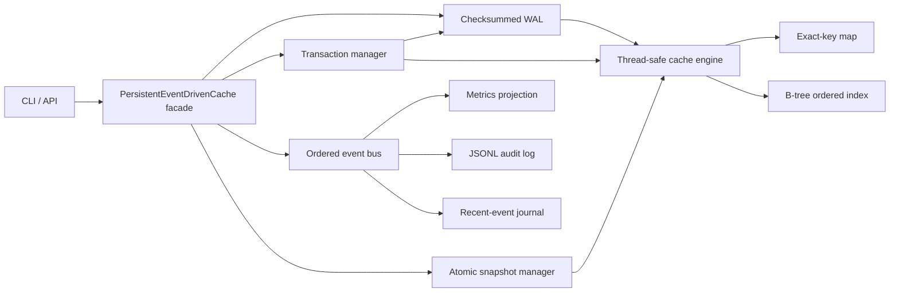

# PERSISTENT EVENT-DRIVEN MEMORY CACHE MODULE
**Academic Mini Project (PR1) — Third-Year B.Tech Computer Engineering (Semester V / VI)**  
**Sardar Patel Institute of Technology (SPIT), Andheri (W), Mumbai**  
**Department of Computer Science and Engineering | Academic Year: 2026–27**  

### Project Team & Supervision
* **Jay Shinde** — UID: `2024800115`
* **Nikhil Shelar** — UID: `2024800113`
* **Sanchit Gaikwad** — UID: `2024800029`
* **Faculty Guide**: **Prof. Suhas Kakade**

---

> ### 📘 MASTER EVALUATION & PROJECT GUIDES
> **For evaluators, viva examiners, and students:**  
> 1. **[HOW_THIS_PROJECT_WORKS_AND_WHAT_IT_IS_ALL_ABOUT.md](file:///Users/jayshinde/Documents/mini%20project/HOW_THIS_PROJECT_WORKS_AND_WHAT_IT_IS_ALL_ABOUT.md)** — Explaining what the project is in simple words, the problem it solves, end-to-end operational workflows, byte-level persistence, and **top 15 viva questions and answers**.  
> 2. **[CHAT.md](file:///Users/jayshinde/Documents/mini%20project/CHAT.md)** — **Full Viva Defense Interview Script**: A realistic conversational dialogue between the Faculty Examiner and the Student team covering the entire viva from opening pitch to 50/50 grading!

---

## Official SPIT Phase-Wise Evaluation Navigation

| Academic Phase | Marks | Status | Primary Documentation & Folder |
|---|---|---|---|
| **Phase 1: Core Engine** | — | Completed | [`phase-1/`](file:///Users/jayshinde/Documents/mini%20project/phase-1) — Java 17 In-Memory Cache Core |
| **Phase 2: Architecture & Design** | **25 Marks** | **100% Complete** | [`Phase2/`](file:///Users/jayshinde/Documents/mini%20project/Phase2) — [SRS.md (10M)](file:///Users/jayshinde/Documents/mini%20project/Phase2/SRS.md) • [UML Diagrams (5M)](file:///Users/jayshinde/Documents/mini%20project/Phase2/UML_DIAGRAMS.md) • [Algorithm Design (5M)](file:///Users/jayshinde/Documents/mini%20project/Phase2/ALGORITHM_DESIGN.md) • [Feature Docs](file:///Users/jayshinde/Documents/mini%20project/Phase2/PHASE_2_FEATURE_DOCUMENTATION.md) • Web Console |
| **Phase 3: Implementation** | **25 Marks** | **100% Complete** | [`Phase_3/`](file:///Users/jayshinde/Documents/mini%20project/Phase_3) — [Module Coding (10M)](file:///Users/jayshinde/Documents/mini%20project/Phase_3/backend) • [Git Setup (5M)](file:///Users/jayshinde/Documents/mini%20project/Phase_3/README.md) • [Branching Strategy (5M)](file:///Users/jayshinde/Documents/mini%20project/Phase_3/README.md) • [40 Viva Q&A](file:///Users/jayshinde/Documents/mini%20project/Phase_3/PROJECT_DOCUMENTATION.md) • [100 Technical Q&A](file:///Users/jayshinde/Documents/mini%20project/Phase_3/PROJECT_VIVA_100_QA.md) • [Phase 4 Roadmap PDF](file:///Users/jayshinde/Documents/mini%20project/Phase_3/Phase_4_Roadmap.pdf) |

---

## Main Objective
Design and implement a fast memory-resident cache module that does not lose acknowledged updates after a process crash, emits ordered events for observability and extension, supports safe concurrent updates, and can rebuild a consistent queryable state from snapshots plus a checksummed write-ahead log.

## Architecture



The critical write order is always:

1. Validate the command and acquire the appropriate coordination lock.
2. Append the logical operation or transaction batch to the WAL.
3. Flush according to the selected durability mode.
4. Apply the versioned change to the memory map and B-tree.
5. Publish an immutable domain event.
6. Let independent subscribers update metrics, audit logs, or other views.

## Project structure

```text
src/main/java/edu/spit/cache/
├── Main.java                    # bootstrap and lifecycle
├── api/                         # public values and CAS results
├── benchmark/                   # workloads, throughput and percentiles
├── cli/                         # demonstration/admin command interface
├── config/                      # immutable runtime configuration
├── core/                        # primary engine, entries and invariants
├── event/                       # event envelope, bus, journal and audit sink
├── eviction/                    # LRU/LFU bounded policy implementations
├── index/                       # generic B-tree
├── metrics/                     # event-derived metrics projection
├── persistence/                 # WAL, snapshots and recovery
├── service/                     # public module facade and checkpoints
└── transaction/                 # transaction state machine and key locks

src/test/java/edu/spit/cache/test/
├── AllTests.java                # named test runner
├── UnitTests.java               # algorithms and component contracts
├── IntegrationTests.java        # restart, crash, TTL, CLI and concurrency
└── TestSupport.java             # assertions and isolated temp configuration
```

See [docs/PROJECT_STRUCTURE.md](docs/PROJECT_STRUCTURE.md) for ownership and dependency rules.

## Requirements

- JDK 17 or newer
- `make` for the shortest commands; Maven is optional
- No database, server, framework, or external Java dependency

## Build, test, package and run

```bash
make verify       # compile with warnings, run 22 tests, create executable JAR
make run          # start the interactive CLI
make demo         # execute a repeatable command script in target/demo
make benchmark    # compare LRU and LFU with latency percentiles
```

The packaged application is created at:

```text
target/persistent-event-driven-cache-3.0.0.jar
```

Run it directly:

```bash
java -jar target/persistent-event-driven-cache-3.0.0.jar
```

## Configuration

Configuration is supplied as JVM system properties. Defaults are safe for a local demonstration.

```bash
java \
  -Dcache.wal=data/cache-v2.wal \
  -Dcache.snapshot=data/cache.snapshot \
  -Dcache.audit=data/cache-events.jsonl \
  -Dcache.durability=ALWAYS \
  -Dcache.events.async=true \
  -Dcache.tx.timeout.ms=30000 \
  -Dcache.expiry.sweep.ms=1000 \
  -jar target/persistent-event-driven-cache-3.0.0.jar
```

An annotated template is available at [config/cache.properties.example](config/cache.properties.example).

## CLI commands

```text
DATA
  SET key value
  SETEX key ttlMs value
  GET key
  GETMETA key
  DELETE key

QUERY AND CONCURRENCY
  SHOW
  RANGE first last
  CAS key expectedVersion value

TRANSACTIONS
  BEGIN
  TGET tx key
  TSET tx key value
  TSETEX tx key ttlMs value
  TDELETE tx key
  COMMIT tx
  ROLLBACK tx

OPERATIONS
  CHECKPOINT
  CHECKPOINT COMPACT
  METRICS
  EVENTS [count]
  HEALTH
  INFO
  RECOVERY
  DIAGNOSTICS
  EVIDENCE
  HELP
  EXIT
```

Values may contain spaces. Keys and transaction IDs are single CLI tokens. The Java API itself is not limited by CLI tokenization.

## Fast crash-recovery demonstration

Terminal 1:

```text
cache> SET account:A 10000
OK value=10000 version=1 ttlMs=-1
cache> SET account:B 5000
OK value=5000 version=2 ttlMs=-1
```

Terminate the process, restart the same command, then run:

```text
cache> RECOVERY
snapshot=0 walApplied=2 incompleteSkipped=0 expiredSkipped=0 malformed=0 checksumFailures=0
cache> RANGE account:A account:Z
account:A = 10000 [v1]
account:B = 5000 [v2]
```

That demonstration proves durability, replay ordering, and ordered indexing in less than one minute.

## Correctness guarantees

- A standalone write reaches the WAL before it is visible in memory.
- A transaction's operation records and `COMMIT` marker are written as one synchronized WAL batch before publication.
- Every new transaction `COMMIT` carries an operation count and SHA-256 digest; recovery rejects the full batch if even one operation is missing or damaged.
- Recovery applies transaction operations only when a valid `COMMIT` exists and no `ABORT` exists.
- WAL sequence numbers become entry versions, allowing stale replay and stale compare-and-set attempts to be rejected.
- An expired record cannot reappear after restart because recovery compares its persisted expiry timestamp with the current time.
- Snapshot replacement and WAL compaction use atomic file replacement when the platform supports it.
- Map and B-tree contents can be compared at runtime through `HEALTH`.
- Event-listener exceptions are counted and isolated; they do not cancel the cache operation or other listeners.
- An OS file lock gives the WAL a single writer and rejects a second process before it can corrupt shared state.

## Testing

`make test` currently executes twenty-two named tests:

- configuration validation;
- map/B-tree invariants;
- stale replay rejection;
- B-tree split, update, range and deletion;
- LRU and LFU victim selection;
- Unicode/Base64 WAL round-trip;
- checksum corruption detection;
- snapshot metadata round-trip;
- ordered events and subscriber failure isolation;
- standalone restart recovery;
- incomplete transaction suppression;
- committed transaction recovery;
- damaged committed transaction batch rejection;
- exclusive WAL writer enforcement;
- compare-and-set version checks;
- TTL expiry before and after restart;
- event-derived metrics;
- write-conflict detection;
- transaction timeout and lock release;
- checkpoint plus WAL compaction;
- operational CLI flow;
- concurrent writer invariant preservation.

The detailed test matrix is in [docs/TEST_PLAN.md](docs/TEST_PLAN.md).

## Benchmark

```bash
make benchmark
# or choose capacity and request count
java -cp target/classes edu.spit.cache.benchmark.Benchmark 200 500000
```

The harness reports hit rate, operations per second, p50/p95/p99 operation latency, and eviction count for uniform, Zipfian and working-set workloads. It is a repeatable educational microbenchmark, not a substitute for JMH.

## Scope and honest limitations

This is a single-process educational module. It does not claim distributed consensus, network replication, cross-process locking, encryption at rest, or database-grade B-tree deletion complexity. The choices are intentional: the project demonstrates the central mechanisms clearly while remaining runnable and explainable by a student team.

The most valuable future extensions are a TCP/HTTP adapter, background WAL group commit, segmented snapshots, a persistent disk-value tier, distributed replication, authentication, encryption, and JMH-based benchmarking.

## Documentation

- [docs/OBJECTIVES_AND_SCOPE.md](docs/OBJECTIVES_AND_SCOPE.md) — main objective, sub-objectives, scope and success criteria
- [docs/ARCHITECTURE.md](docs/ARCHITECTURE.md) — components, write/recovery sequences and design decisions
- [docs/PROJECT_STRUCTURE.md](docs/PROJECT_STRUCTURE.md) — package ownership and coding conventions
- [docs/TEST_PLAN.md](docs/TEST_PLAN.md) — verification matrix and demo evidence
- [docs/VIVA_HANDBOOK_50_PAGES.md](docs/VIVA_HANDBOOK_50_PAGES.md) — fifty-page technical explanation and viva question bank
- [COMPLETE_PROJECT_EXPORT.md](COMPLETE_PROJECT_EXPORT.md) — original proposal/history
- [PRESENTATION_GUIDE_FOR_MAAM.md](PRESENTATION_GUIDE_FOR_MAAM.md) — presentation material from the earlier version
