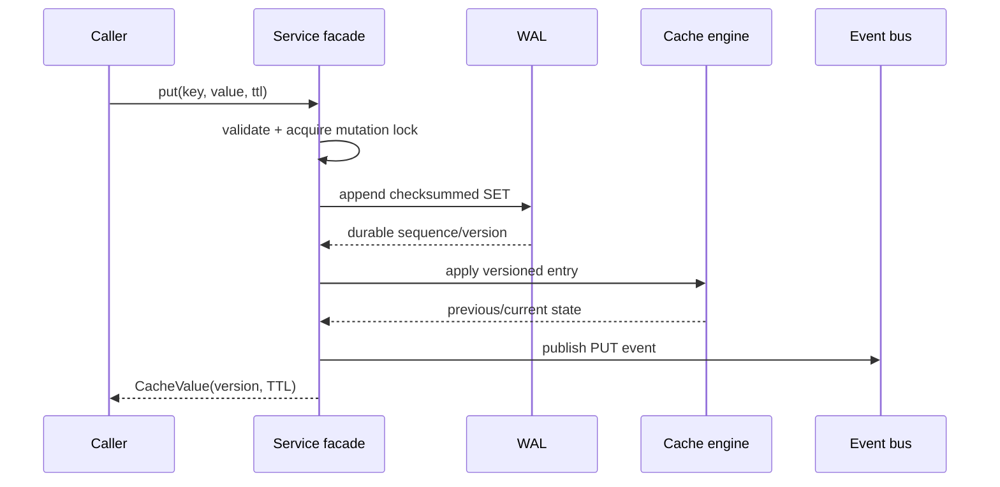

# Architecture and Design Decisions

## Write sequence



The returned version is the WAL sequence. This unifies durability ordering, idempotent recovery, and optimistic concurrency.

## Transaction sequence

```mermaid
sequenceDiagram
    participant C as Caller
    participant T as Transaction manager
    participant W as WAL
    participant E as Cache engine
    participant B as Event bus
    C->>T: BEGIN
    T->>W: BEGIN record
    C->>T: TSET A; TSET B
    T->>T: buffer + acquire key ownership
    C->>T: COMMIT
    T->>T: compute count + SHA-256 batch manifest
    T->>W: TX_SET A + TX_SET B + COMMIT(manifest) (one batch)
    W-->>T: fsync completed
    T->>E: publish both entries
    T->>B: TRANSACTION_COMMITTED
    T-->>C: success
```

An incomplete transaction has no valid `COMMIT`, so recovery ignores its data operations. For new transactions, `COMMIT` also stores the expected operation count and a SHA-256 digest over operation type, key, value and expiry. Recovery recomputes the manifest and rejects the whole transaction when any member is missing or damaged. Staged operations are normally only written at commit time, reducing log noise and guaranteeing one batch boundary.

## Recovery sequence

1. Read and validate the snapshot header and entry checksums.
2. Advance the WAL sequence floor to the snapshot sequence.
3. Restore non-expired snapshot entries into both the map and B-tree.
4. Scan WAL records and count malformed/checksum failures.
5. Group transaction records and identify committed and aborted IDs after the snapshot boundary.
6. Recompute each committed transaction manifest; classify it as verified, legacy-unverified, or invalid.
7. Replay standalone mutations in sequence order.
8. Replay transaction data only for verified (or backward-compatible legacy), committed, non-aborted IDs.
9. Convert already-expired SET records into absence instead of resurrecting values.
10. Publish a recovery event and expose skipped operations, rejected batches, legacy batches, malformed records and checksum failures through the CLI.

## Event design

The event bus uses one worker in asynchronous mode. A single worker keeps publication order deterministic. Each listener call is isolated in its own `try/catch`, so an audit-disk problem does not prevent metrics or later listeners from receiving the event. Synchronous mode exists for deterministic tests.

Events are facts, not commands. A `PUT` event says a write was persisted and applied. A listener does not decide whether the write should happen.

## Snapshot and compaction safety

A checkpoint is created while the service mutation lock is held. The snapshot is written to a sibling temporary file, forced to disk, and atomically moved over the previous snapshot when supported. WAL records up to the snapshot sequence can then be removed. On restart, the WAL sequence is raised to at least the snapshot sequence, preventing version reuse after compaction.

## Concurrency model

- The service mutation lock serializes WAL-before-memory mutations and snapshot boundaries.
- The engine uses a fair read/write lock to protect the primary map and B-tree invariant.
- The transaction manager uses a fair mutex for transaction tables and key owners.
- Transaction commit acquires the transaction mutex before the global mutation lock; other service operations never request the transaction mutex, preventing a lock cycle.
- Compare-and-set checks and writes execute under the mutation lock, so the observed version cannot change between validation and WAL append.
- A separate OS file lock (`<wal>.lock`) is held for the full WAL lifetime. A second JVM or process fails fast before opening the shared log.

## Layered integrity: CRC32 plus SHA-256

CRC32 is fast and local: it detects accidental truncation or bit corruption in one WAL record. The transaction SHA-256 manifest is structural: it proves that the complete expected operation set reached recovery unchanged. Neither is authentication against a malicious writer because the project has no secret key. A production security design would add authenticated encryption or a MAC.

## Diagnostics evidence path

`DIAGNOSTICS` (alias `EVIDENCE`) assembles one immutable operational view: module state, map/B-tree invariant result, event-derived metrics, startup recovery counters, event-delivery statistics, WAL/snapshot/audit sizes and uptime. It is designed for ESE demonstrations and incident triage without bypassing component boundaries.

## Why two data structures

The primary map optimizes exact-key lookup. The B-tree maintains lexicographic order for inclusive ranges. Maintaining both intentionally demonstrates a database-style secondary index invariant: every applied write must update both, and `HEALTH` verifies they agree.
