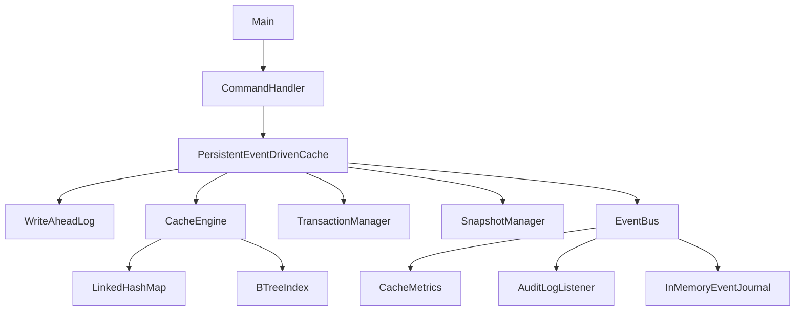

# PERSISTENT EVENT-DRIVEN MEMORY CACHE MODULE

## Fifty-Page Technical Report and Viva Defence Handbook

**Team:** Jay Umesh Shinde, Sanchit Gaikwad, Nikhil Shelar  
**Institution:** Sardar Patel Institute of Technology  
**Implementation:** Java 17, dependency-free  
**Document purpose:** complete project explanation, design defence, demonstration guide, and examiner question bank

> Pagination note: every numbered section below is intentionally written as one logical report page. The HTML page-break markers allow clean PDF conversion from a Markdown renderer.

---

## Page 1 of 50 — Title, identity, and central promise

### Project title

**PERSISTENT EVENT-DRIVEN MEMORY CACHE MODULE**

### One-sentence definition

This project is a memory-resident key/value module that records durable intent before changing RAM, rebuilds consistent state after failure, and publishes ordered domain events so metrics, audit, and future integrations remain independent from the core write path.

### Main objective

The main objective is to design, implement, and verify a fast in-memory cache that does not lose acknowledged updates after a process crash, supports safe concurrent and transactional changes, provides exact and ordered queries, and exposes its behavior through events, metrics, audit records, recovery reports, and runtime health checks.

### Central presentation promise

The team should open the viva with one question: **“Can a cache survive its own crash?”** The answer is yes, provided that the system writes a durable, valid, ordered record before publishing the change in volatile memory. The project demonstrates that answer with working code rather than only a diagram.

### What we can prove live

- A successful `SET` survives restart.
- An incomplete transaction is ignored.
- A committed multi-key transaction returns completely.
- A stale compare-and-set is rejected.
- A TTL value disappears and does not resurrect.
- A checkpoint restores data after the WAL is compacted.
- `HEALTH` confirms the map and B-tree agree.
- `METRICS` and `EVENTS` expose actual behavior.

### Viva quick answer

**Q: What is the single most important idea in the project?**  
**A:** The WAL-before-memory invariant. A write is acknowledged only after its durable intent is recorded; therefore recovery can reconstruct every acknowledged state change.

<div style="page-break-after: always;"></div>

## Page 2 of 50 — Abstract

Traditional caches are fast because they keep data in volatile memory. That strength becomes a weakness when the process terminates: memory state disappears. This project closes that gap with a versioned write-ahead log, snapshot-based checkpoints, and deterministic recovery. Each successful mutation receives a monotonic WAL sequence number that also becomes the value version. The same version supports idempotent replay and optimistic compare-and-set operations.

The module is event-driven in a concrete architectural sense. After persistence and state application, it publishes an immutable event through an ordered dispatcher. Independent subscribers derive metrics, maintain a bounded recent-event journal, and append a JSON Lines audit trail. Subscriber failures are isolated and counted, so an observer cannot cancel the primary cache operation or prevent other subscribers from receiving the event.

Atomic multi-key transactions buffer updates, acquire exclusive per-key ownership, persist all operation records plus a `COMMIT` marker as one synchronized batch, and only then publish changes to memory. Recovery replays transaction operations only when a valid commit exists and no abort exists. Transaction timeouts release abandoned locks. TTL metadata is persisted, checked during foreground reads and background maintenance, and respected during recovery.

Exact-key access uses a thread-safe map. A generic B-tree maintains lexicographic order for inclusive range queries. Separate bounded LRU and LFU implementations allow policy comparison under uniform, Zipfian, and working-set traffic. The benchmark reports hit rate, throughput, latency percentiles, and eviction count.

The result is a professional, dependency-free Java 17 teaching module that connects data structures, DBMS recovery, operating-system durability, concurrency control, object-oriented design, testing, and observability.

### Viva quick answers

**Q: Is this only a cache algorithm project?**  
**A:** No. LRU/LFU are one subsystem. The main system also covers durability, recovery, transactions, events, TTL, concurrency, snapshots, checksums, indexing, metrics, and operations.

**Q: Why Java 17?**  
**A:** It gives records, text blocks, modern switch expressions, strong concurrency primitives, NIO file channels, and long-term-support availability without external libraries.

<div style="page-break-after: always;"></div>

## Page 3 of 50 — Problem statement

An ordinary in-memory cache usually has three problems when used for important state.

First, memory is volatile. If the process crashes after telling the caller that a write succeeded, the value may be gone on restart. That violates the caller's reasonable durability expectation.

Second, multi-key changes can become partial. Consider a transfer that subtracts ₹5,000 from account A and adds ₹5,000 to account B. If only one update becomes visible or recoverable, the system violates atomicity.

Third, internal behavior is often invisible. A student implementation may return values but provide no evidence about recovery, corruption, hit rate, conflicts, expiry, or event order. This makes both operation and evaluation weak.

The project problem is therefore broader than “store keys in a `HashMap`.” It asks how to combine RAM speed with durable intent, transaction boundaries, ordered querying, TTL semantics, concurrency coordination, event-driven observability, and testable failure behavior.

### Requirements derived from the problem

1. Never apply an acknowledged standalone mutation before its WAL record exists.
2. Never replay a transaction without a valid commit marker.
3. Never apply a corrupted WAL record.
4. Never reuse a version after snapshot compaction.
5. Never return an expired value or resurrect it after restart.
6. Never let two active transactions own the same key for writing.
7. Never allow the map and ordered index to silently diverge.
8. Never let an event subscriber failure break primary correctness.

### Viva quick answers

**Q: Why not simply serialize the whole map after every write?**  
**A:** Rewriting the entire state is O(n), causes more I/O, and creates a large failure window. Appending one WAL record is proportional to the operation and is easier to make durable.

**Q: What failure model do you assume?**  
**A:** Single-process crashes and incomplete/corrupted local log records. The project does not claim tolerance of distributed partitions or simultaneous multi-process writers.

<div style="page-break-after: always;"></div>

## Page 4 of 50 — Motivating use case

Imagine an ATM-like operation stored temporarily in a memory cache. The current balance of `account:A` is ₹10,000. A withdrawal changes it to ₹5,000. A basic implementation performs `map.put("account:A", "5000")` and returns `OK`. If power is lost immediately afterward, the memory state disappears and the application may restart with an older balance.

The upgraded module performs a different sequence:

1. Validate the key, value, TTL and command form.
2. Acquire the service mutation lock.
3. Create a `SET` draft.
4. Assign a new sequence number.
5. encode the key and value safely.
6. Calculate CRC32 over the record payload.
7. Append the complete line to the WAL.
8. Force the file to stable storage in `ALWAYS` mode.
9. Apply the entry to the map and B-tree.
10. Publish a `PUT` event.
11. Return the value and its version.

If the process crashes after step 8, recovery finds the WAL record and restores the value. If it crashes before step 8, the method has not acknowledged success. This boundary is the essence of a correct durable write path.

For a transfer, the transaction manager buffers both account changes. At commit, it writes two `TX_SET` records and one `COMMIT` marker as one batch. Only after the batch is durable are both values placed in memory.

### Viva quick answers

**Q: What if the process crashes after WAL append but before memory update?**  
**A:** The current process may not show the change, but restart recovery replays the WAL, so the acknowledged update is not lost.

**Q: What if it crashes before the WAL append completes?**  
**A:** A partial or checksum-invalid final record is skipped and counted. Since success was not returned, durability is not promised for that operation.

**Q: Why is the event published last?**  
**A:** A `PUT` event must describe an already persisted and applied fact. Publishing earlier could make observers react to a change that later fails.

<div style="page-break-after: always;"></div>

## Page 5 of 50 — Scope, non-scope, and academic mapping

### In scope

- A single Java process with multiple threads.
- String keys and values with spaces, commas, tabs and Unicode safely encoded in durable files.
- Standalone `SET`, `DELETE`, TTL and compare-and-set operations.
- Atomic buffered transactions with commit, rollback, timeout and conflict detection.
- Versioned checksummed WAL and atomic snapshots.
- Snapshot-first recovery plus WAL replay.
- Exact lookup and inclusive lexicographic ranges.
- Ordered domain events, metrics, audit log and recent event history.
- LRU/LFU policy implementations and deterministic benchmark workloads.
- CLI, executable JAR, configuration properties and automated tests.

### Explicit non-scope

- Distributed consensus, leader election or replication.
- Cross-process file locking.
- Authentication, authorization or network encryption.
- Cryptographic WAL authentication.
- SQL or arbitrary predicates.
- Multi-gigabyte production datasets.
- Claims that the custom benchmark replaces JMH.

Stating non-scope is a professional strength. It shows that the team knows where guarantees stop and does not overclaim.

### Academic subject mapping

| Subject | Project evidence |
|---|---|
| Data Structures and Algorithms | Hash-based exact lookup, B-tree ordering, LRU, LFU, frequency buckets |
| DBMS | WAL, atomicity, recovery, transaction states, checkpoints, versioning |
| Operating Systems | Volatile vs durable state, fsync, file channels, background worker, locks |
| Object-Oriented Programming | Packages, interfaces, immutable records, facade, composition, lifecycle |
| Software Engineering | Requirements, scope, tests, documentation, configuration, failure reports |
| Computer Networks / Distributed Systems foundation | Event envelopes, ordered delivery, idempotence, version conflicts |

### Viva quick answers

**Q: Is it a database?**  
**A:** It uses database recovery ideas but remains a single-process cache module. It has no SQL optimizer, disk page manager, or distributed transaction protocol.

**Q: Why mention limitations during viva?**  
**A:** Clear boundaries make the guarantees credible and show engineering judgment.

<div style="page-break-after: always;"></div>

## Page 6 of 50 — Functional and non-functional requirements

### Functional requirements

FR1. Store and retrieve a value by key.  
FR2. Delete a key idempotently.  
FR3. List all current non-expired values.  
FR4. Query an inclusive ordered key range.  
FR5. Attach an optional TTL to a write.  
FR6. Return version and TTL metadata.  
FR7. Perform compare-and-set using an expected version.  
FR8. Begin, read, stage, commit and rollback a transaction.  
FR9. Detect transaction key conflicts and deadlines.  
FR10. Recover from a snapshot and WAL.  
FR11. Create a checkpoint and optionally compact the WAL.  
FR12. Inspect metrics, events, recovery state, configuration and health.  
FR13. Run LRU/LFU benchmarks.

### Non-functional requirements

NFR1. Acknowledged writes must be recoverable in `ALWAYS` durability mode.  
NFR2. Event publication order must be deterministic.  
NFR3. Observer failure must not corrupt primary state.  
NFR4. Recovery must not apply checksum-invalid records.  
NFR5. Components must compile on Java 17 without third-party libraries.  
NFR6. Concurrency must preserve map/index invariants.  
NFR7. Tests must not modify the developer's actual data directory.  
NFR8. File formats must be versioned.  
NFR9. Configuration must be validated at startup.  
NFR10. The code must be organized by responsibility rather than one large package.

### Traceability examples

- FR10 maps to `RecoveryManager`, `SnapshotManager`, `WriteAheadLog`, and restart tests.
- NFR2 maps to the single-thread event dispatcher and event-order unit test.
- NFR4 maps to `WalRecord.parseV2`, CRC32, `WalReadResult`, and corruption test.
- NFR6 maps to the service mutation lock, engine read/write lock, `HEALTH`, and concurrent writer test.

### Viva quick answers

**Q: Difference between functional and non-functional requirements?**  
**A:** Functional requirements describe what the module does. Non-functional requirements describe the quality and constraints under which it must do it.

**Q: Which requirement is hardest?**  
**A:** Atomic crash recovery, because correctness must hold across both concurrency boundaries and failure boundaries.

<div style="page-break-after: always;"></div>

## Page 7 of 50 — System architecture overview

The module uses a layered composition. `Main` loads `CacheConfig` and opens one `PersistentEventDrivenCache`. That facade owns all stateful resources and gives the CLI a small, coherent API.



### Architectural rules

1. The CLI parses and formats; it does not implement persistence.
2. The facade coordinates; it does not parse console strings.
3. The engine owns state; it does not open files.
4. Persistence owns serialization; it does not print to the user.
5. Events carry facts; listeners do not decide the write result.
6. The B-tree is generic and does not depend on cache service classes.
7. Metrics subscribe to events rather than being manually changed by every method.

### Why a facade?

Without a facade, callers would need to know the correct ordering among WAL, engine, snapshot, metrics, transaction locks, and events. That is dangerous. The facade makes the legal operation path the easiest path and centralizes lifecycle shutdown.

### Viva quick answers

**Q: Which design pattern is used?**  
**A:** A facade composes subsystems; observer/event bus decouples projections; strategy is used by LRU/LFU through `CachePolicy`; immutable records act as value objects.

**Q: Is this microservices architecture?**  
**A:** No. It is a modular monolith. The boundaries are clean enough to extract adapters later, but all components run in one process.

<div style="page-break-after: always;"></div>

## Page 8 of 50 — Professional package structure

The original project placed nearly every class in one package. Version 3 organizes code by responsibility:

```text
edu.spit.cache
├── api          public immutable result records
├── benchmark    workload generation and measurements
├── cli          human command adapter
├── config       validated runtime configuration
├── core         memory state and invariants
├── event        event contracts and subscribers
├── eviction     LRU/LFU strategies
├── index        generic B-tree
├── metrics      event-derived counters
├── persistence  WAL, snapshot and recovery
├── service      public facade and reports
└── transaction  transaction state and locking
```

This is not cosmetic. Package boundaries communicate ownership and dependency direction. For example, the B-tree can be tested without creating a WAL. The WAL can be tested without starting the CLI. A future HTTP controller can call the service facade without changing recovery code.

### Important classes

- `PersistentEventDrivenCache`: correctness boundary and resource owner.
- `CacheEngine`: synchronized map and B-tree state.
- `WriteAheadLog`: durable versioned record stream.
- `SnapshotManager`: atomic checkpoint format.
- `RecoveryManager`: deterministic materialization algorithm.
- `TransactionManager`: transaction state machine and key ownership.
- `EventBus`: ordered dispatch and failure isolation.
- `CacheMetrics`: projection built from events.
- `CommandHandler`: viva/demo interface.

### Viva quick answers

**Q: Why not create one class per operation?**  
**A:** Too many tiny classes can make a student project harder to follow. The structure separates real responsibilities without turning every method into a type.

**Q: What is cohesion?**  
**A:** A cohesive class has closely related responsibilities. `SnapshotManager` only reads and writes snapshots; it does not handle CLI or metrics.

**Q: What is coupling?**  
**A:** Coupling is dependency between components. Event subscribers reduce coupling because the service publishes one fact instead of calling every observer's business method directly.

<div style="page-break-after: always;"></div>

## Page 9 of 50 — Domain data model

### `CacheEntry`

The internal immutable record contains:

- `key`: identity used by map and B-tree;
- `value`: stored string;
- `version`: WAL sequence that created the current value;
- `createdAtEpochMillis`: persisted creation timestamp;
- `expiresAtEpochMillis`: absolute expiry time or zero for no expiry.

Using an absolute expiry timestamp is important. If the project stored “TTL = 5 seconds” and restarted three seconds later, recovery might incorrectly grant a fresh five seconds. An absolute timestamp preserves the original expiry deadline.

### `CacheValue`

The public API does not expose the engine's internal record directly. It returns `CacheValue`, which includes the user value and metadata. Its `ttlMillis(now)` method returns `-1` for a persistent value and the remaining non-negative time for an expiring value.

### WAL sequence as version

One number serves three related jobs:

1. It orders durable operations.
2. It prevents an older replay record from overwriting a newer value.
3. It lets the caller use compare-and-set to detect a lost update.

This is a strong design because version meaning is grounded in the durable history rather than an unrelated in-memory counter.

### Event envelope

`CacheEvent` contains an event ID, timestamp, type, optional key, optional transaction ID, detail text, and attributes. The event ID orders publication inside one running process; the WAL sequence orders durable mutations across restart.

### Viva quick answers

**Q: Why are records immutable?**  
**A:** Immutability prevents accidental shared-state mutation, makes event delivery safer, and simplifies reasoning during concurrency and recovery.

**Q: Are event ID and WAL sequence the same?**  
**A:** No. Event IDs restart with the process and order observed events. WAL sequences persist and version durable mutations.

<div style="page-break-after: always;"></div>

## Page 10 of 50 — Event-driven design principle

“Event-driven” means that meaningful state transitions are represented as immutable events and delivered to interested subscribers. It does not mean merely naming a class `Event` or printing messages.

The module publishes events such as `PUT`, `DELETE`, `HIT`, `MISS`, `EXPIRED`, `CAS_SUCCEEDED`, `TRANSACTION_COMMITTED`, `TRANSACTION_CONFLICT`, `SNAPSHOT_CREATED`, `WAL_COMPACTED`, `RECOVERY_COMPLETED`, and `INVARIANT_CHECKED`.

### Command versus event

- A command requests future work: “set key A to 10.”
- An event reports a completed fact: “key A was persisted and applied at version 21.”

This difference determines timing. The service publishes a `PUT` event after WAL and memory success, not before.

### Benefits

1. Metrics do not pollute the write algorithm.
2. Audit logging can be added or removed through subscription.
3. A recent-event view helps live demonstration.
4. Future subscribers could invalidate a UI, update a dashboard, or forward to a message broker.
5. Listener failures are measurable and isolated.
6. Tests can assert behavior by examining events.

### Delivery guarantee in this project

The bus guarantees ordered best-effort delivery inside one process. In asynchronous mode, one dedicated worker processes events sequentially. This is not a durable message broker. If the process dies after the cache write but before an asynchronous listener runs, the durable state remains correct but that in-memory event delivery may be lost. The WAL is the durability source; the event bus is an observability/extension mechanism.

### Viva quick answers

**Q: Is event-driven architecture automatically asynchronous?**  
**A:** No. Events describe decoupling. Delivery can be synchronous or asynchronous. The project supports both.

**Q: Why only one dispatcher thread?**  
**A:** It preserves total event order and makes behavior easy to explain. Higher throughput could use partitioned ordering in a future version.

**Q: Is the event bus durable?**  
**A:** No. Durable truth is in the WAL and snapshot. The audit subscriber persists a separate operational record, but correctness never depends on it.

<div style="page-break-after: always;"></div>

## Page 11 of 50 — Event bus implementation

`EventBus` owns a copy-on-write list of listeners, an atomic event sequence, delivery counters, failure counters, and an optional single-thread executor. `publish` creates the complete immutable event before dispatch. In synchronous mode, the publisher calls listeners immediately. In asynchronous mode, the event is placed on the executor queue and delivered later in the same order.

### Failure isolation

Each listener invocation is wrapped independently. If the audit listener throws because its disk is unavailable, the metrics listener and recent journal still receive the event. The failure increments `listenerFailures`. This is better than one outer `try/catch`, which would skip all later listeners after the first failure.

### Subscription lifecycle

`subscribe` returns an `AutoCloseable` removal handle. This small design supports safe dynamic unsubscription without exposing the internal list. The service keeps long-lived listeners for the lifetime of the module.

### Graceful shutdown

Before closing, the facade calls `awaitQuiescence`. The bus places a latch action behind all previously submitted events. When that latch runs, earlier events have completed. Then the dispatcher is shut down. This prevents normal application shutdown from abandoning queued audit or metrics work.

### Statistics

- `published`: number of event envelopes created;
- `deliveries`: successful listener calls, not unique events;
- `listenerFailures`: subscriber calls that threw.

If ten events are sent to three listeners and all succeed, published is 10 and deliveries is 30.

### Viva quick answers

**Q: Why `CopyOnWriteArrayList`?**  
**A:** Subscriptions change rarely, while event delivery iterates frequently. It gives safe iteration without holding a delivery lock.

**Q: Could one slow listener delay all others?**  
**A:** Yes, because ordered delivery is serial. That is an intentional simplicity trade-off; a future version could use per-subscriber queues with ordering rules.

**Q: What is backpressure here?**  
**A:** The executor queue can grow if listeners are slower than publishers. The current project measures failure but does not bound that queue. A production version would define a bounded queue and overflow policy.

<div style="page-break-after: always;"></div>

## Page 12 of 50 — Event catalogue and semantics

### Data events

- `PUT`: a standalone value was persisted and applied.
- `DELETE`: a delete request was persisted; the detail states whether a value existed.
- `HIT`: a non-expired key was returned.
- `MISS`: no current value was available.
- `EXPIRED`: TTL elapsed and an entry was removed.
- `RANGE_QUERIED`: a B-tree range operation completed.

### Concurrency events

- `CAS_SUCCEEDED`: observed version matched and a versioned write completed.
- `CAS_REJECTED`: expected version did not match the current version.
- `TRANSACTION_BEGAN`: a transaction ID and deadline were created.
- `TRANSACTION_COMMITTED`: the durable batch was applied.
- `TRANSACTION_ROLLED_BACK`: the caller aborted active work.
- `TRANSACTION_CONFLICT`: another active transaction owned a requested key.
- `TRANSACTION_TIMED_OUT`: the deadline passed and locks were released.

### Operational events

- `SNAPSHOT_CREATED`: a point-in-time snapshot became durable.
- `WAL_COMPACTED`: snapshot-covered records were removed.
- `RECOVERY_COMPLETED`: startup materialization produced a report.
- `INVARIANT_CHECKED`: map/B-tree health was examined.

### Event attributes

Events can include a map of string attributes. A successful put includes `version` and `expiresAt`. A transaction commit includes operation count. A recovery event includes snapshot entries, WAL applied count and checksum failures. These attributes allow subscribers to evolve without expanding the fixed event record for every feature.

### Semantic caution

Metrics count logical events, not low-level method calls. For example, transaction operations produce a `TRANSACTION_COMMITTED` count rather than pretending each staged write was a standalone `PUT`. This prevents confusing duplicate metrics.

### Viva quick answers

**Q: Why not create one Java subclass for every event type?**  
**A:** A single envelope plus enum keeps this educational system compact. Separate classes become useful when event schemas differ greatly or require compiler-enforced fields.

**Q: Can events rebuild the cache?**  
**A:** Not in this design. Recovery uses the WAL because it has durability, checksums, transaction markers and persistent versions.

<div style="page-break-after: always;"></div>

## Page 13 of 50 — Metrics, audit, and projections

`CacheMetrics` is a projection over the event stream. It implements `CacheEventListener` and increments thread-safe `LongAdder` counters. This creates an important separation: the service publishes facts; the metrics component decides which facts become counters.

### Exposed metrics

- hits and misses;
- calculated hit-rate percentage;
- puts and deletes;
- expirations;
- successful and rejected compare-and-set operations;
- transaction commits, rollbacks/timeouts and conflicts;
- snapshot and recovery counts.

`LongAdder` is suitable for counters updated from concurrent threads because it reduces contention compared with one atomic value under heavy updates. The snapshot operation sums the current cells into an immutable `MetricsSnapshot`.

### Audit log

`AuditLogListener` appends one JSON object per line. JSON Lines is chosen because:

1. appending is simple;
2. one damaged line does not invalidate the whole file;
3. common command-line and data tools can stream it;
4. it is human-readable during evaluation;
5. no third-party JSON dependency is required.

The implementation escapes slash, quote, newline and carriage-return characters. The audit log is operational evidence, not the recovery source. If audit writing fails, the bus records a listener failure while the WAL-protected cache remains correct.

### Recent journal

`InMemoryEventJournal` stores only the latest configured number of events in an `ArrayDeque`. When full, it removes the oldest event. The CLI `EVENTS 10` uses this journal for immediate demonstration without scanning the audit file.

### Viva quick answers

**Q: Difference between log, audit log and metric?**  
**A:** The WAL is durable recovery state; the audit log is a human/tool-readable operational history; a metric is an aggregated numeric projection.

**Q: Why derive metrics from events?**  
**A:** It avoids duplicating counting logic across service methods and proves that event-driven extensions can be independent.

<div style="page-break-after: always;"></div>

## Page 14 of 50 — Standalone write path in detail

The public `put` operation executes under the facade's fair `mutationLock`. This lock protects the critical ordering across WAL, memory and snapshot boundaries.

### Algorithm

```text
PUT(key, value, ttl):
  validate key, value and ttl
  acquire mutation lock
  expiresAt = ttl == 0 ? 0 : now + ttl
  record = WAL.append(SET, key, value, expiresAt)
  entry = CacheEntry(key, value, record.sequence, record.time, expiresAt)
  engine.put(entry)
  publish PUT(version, expiresAt)
  release mutation lock
  return public CacheValue
```

### Why WAL first?

If memory changed first and the process crashed before logging, the caller might observe a value that recovery could never reconstruct. WAL first makes any acknowledged write discoverable on restart.

### Why hold the lock through event publication?

The essential correctness requirement only needs the lock through memory application. Keeping publication inside the method also makes event order match mutation order. Because asynchronous delivery is queued quickly, the critical section remains small. A higher-throughput version could create the event inside the lock and dispatch just after releasing it while preserving sequence.

### Delete path

Delete is also written before memory mutation. It is idempotent: deleting a missing key still records intent and reports `NOT FOUND`, but repeating recovery cannot create a value. The WAL sequence of the delete prevents an older replay from overriding a newer current entry.

### Complexity

- WAL append: O(record size), plus storage latency.
- Map put: O(1) average.
- B-tree put: O(log n).
- Event enqueue: O(1) average.

### Viva quick answers

**Q: Is the whole PUT O(1)?**  
**A:** No. Exact map access is O(1) average, but durable I/O dominates latency and the ordered index update is O(log n).

**Q: What is the linearization point?**  
**A:** For durability, it is the successful WAL force in `ALWAYS` mode. For in-process visibility, it is the engine application immediately after that.

<div style="page-break-after: always;"></div>

## Page 15 of 50 — Versioned WAL record format

The V2 WAL is line-oriented and tab-separated. A conceptual record is:

```text
V2  sequence  timestamp  txId  operation  expiresAt  keyBase64  valueBase64  crc32
```

### Field meanings

- `V2`: explicit file-format version.
- `sequence`: strictly increasing logical order and value version.
- `timestamp`: creation time in epoch milliseconds.
- `txId`: `-` for standalone writes or a transaction ID.
- `operation`: `SET`, `CAS`, `DELETE`, `BEGIN`, `TX_SET`, `COMMIT`, etc.
- `expiresAt`: absolute TTL deadline, or zero.
- `keyBase64` / `valueBase64`: delimiter-safe UTF-8 data.
- `crc32`: integrity checksum of the preceding payload fields.

### Monotonic sequence allocation

`WriteAheadLog` scans existing valid records at startup and initializes an `AtomicLong` to the highest sequence. Each append increments it. After WAL compaction, the snapshot sequence is used as a minimum sequence floor. This avoids the subtle bug of restarting at version 1 after deleting old WAL records.

### Batch append

Transaction commit creates all records first, combines them into one byte buffer, writes the buffer while holding the WAL monitor, and performs one force operation. This preserves contiguous ordering and avoids fsync per transaction operation.

### Backward compatibility

The reader recognizes the original five-column format and converts legacy records into the new in-memory representation with assigned sequence numbers. New writes always use V2.

### Viva quick answers

**Q: Why version the file format?**  
**A:** It allows format evolution and explicit parsing. Without a version, future fields can be misinterpreted silently.

**Q: Why line-oriented instead of Java serialization?**  
**A:** It is inspectable, append-friendly, language-neutral, easier to recover partially, and avoids Java serialization security and compatibility problems.

<div style="page-break-after: always;"></div>

## Page 16 of 50 — Encoding, checksum, and corruption handling

Keys and values may contain commas, spaces, tabs, line-like text or Unicode. Directly placing them into a tab-separated log would make parsing ambiguous. The WAL converts UTF-8 bytes to URL-safe Base64 without padding. Decoding reconstructs the exact original string.

### Checksum calculation

The serializer joins the first eight fields into one payload. `CRC32` processes the UTF-8 bytes and writes an uppercase hexadecimal checksum as the ninth field. The reader recomputes the checksum before decoding and applying the record.

### Recovery behavior

- Wrong field count: increment `malformedRecords`.
- Invalid number, operation or Base64: increment `malformedRecords`.
- Checksum mismatch: increment `checksumFailures`.
- Blank line: ignore.
- Valid record: sort and consider for replay.

Invalid records are not applied. Importantly, the system reports the counts through `RECOVERY` instead of silently hiding damage.

### Why CRC32 is not security

CRC32 detects accidental changes well but is not keyed and is easy for an attacker to recompute. It provides integrity against truncation/bit errors, not authenticity against malicious modification. A security-focused version would use a message authentication code or authenticated encryption with managed keys.

### Partial final record

An abrupt crash can leave a final line incomplete. The field-count or checksum check rejects it. Earlier complete records remain independently readable because the format is one record per line.

### Viva quick answers

**Q: Why Base64 if it increases file size?**  
**A:** It trades approximately 33% size overhead for unambiguous, dependency-free and Unicode-safe parsing—appropriate for this teaching system.

**Q: Could you use SHA-256 instead?**  
**A:** Yes, but an unkeyed SHA hash still does not provide authenticity. CRC32 is faster and sufficient for accidental-corruption detection in scope.

<div style="page-break-after: always;"></div>

## Page 17 of 50 — Durability modes and filesystem behavior

The configuration exposes two durability modes.

### `ALWAYS`

After writing each standalone record or transaction batch, the WAL calls `FileChannel.force(true)`. This requests that file content and metadata reach durable storage before success returns. It provides the strongest crash guarantee available in this local design, though actual guarantees still depend on the operating system, filesystem and hardware.

### `OS_BUFFERED`

The record is written through the file channel but not forced on every operation. The operating system may keep bytes in its page cache. This mode improves throughput and is useful for tests or low-value cache data, but a sudden power loss can lose recently acknowledged bytes.

### Why configuration is explicit

Durability and speed are a trade-off, not a hidden implementation detail. A professional system lets the operator choose and exposes the active mode through `INFO`.

### Process crash versus power failure

- On a normal process crash, bytes already copied to the OS page cache often remain available.
- On total power loss, only bytes forced through the storage stack are expected to survive.

The viva should distinguish these. Saying “flush” without explaining fsync is incomplete.

### Transaction group benefit

A transaction with ten updates uses one batched append and one force instead of ten independent forces. This both preserves a contiguous commit history and reduces durability overhead.

### Viva quick answers

**Q: Does `writer.flush()` guarantee disk durability?**  
**A:** No. It moves data from language-level buffers to the OS, but the OS may still cache it. `FileChannel.force` or `FileDescriptor.sync` requests stable storage.

**Q: Is `force(true)` absolutely guaranteed on every device?**  
**A:** It is the Java/OS durability request, but final guarantees depend on the filesystem and hardware controller. Good engineering states that boundary.

<div style="page-break-after: always;"></div>

## Page 18 of 50 — Snapshot and checkpoint design

Replaying an indefinitely growing WAL makes startup cost grow with the complete history. A snapshot stores the current materialized state and the last WAL sequence it covers.

### Snapshot header

```text
PEDS-CACHE-SNAPSHOT  1  lastWalSequence  createdAt  entryCount
```

Each entry line stores Base64 key/value, version, creation time, expiry time, and CRC32. The entry count allows the reader to detect a truncated snapshot even if individual earlier lines remain valid.

### Atomic write algorithm

1. Acquire the service mutation lock.
2. Purge expired entries.
3. capture current entries and WAL sequence.
4. Write the complete snapshot to a sibling temporary file.
5. Force the temporary file.
6. Atomically replace the old snapshot when supported.
7. Optionally compact WAL records up to the covered sequence.
8. Publish snapshot and compaction events.

Writing directly over the active snapshot would risk leaving no valid snapshot after a crash. Temporary-plus-rename makes either the old complete file or the new complete file visible.

### Why the mutation lock matters

Without a stable boundary, the snapshot might include the memory effect of sequence 10 while declaring that it covers only sequence 9, or the opposite. The same lock used by writes makes the captured state and sequence correspond.

### Viva quick answers

**Q: Is a snapshot the same as a backup?**  
**A:** No. It accelerates local recovery and can be part of a backup, but a real backup must be copied to an independent failure domain and tested for restore.

**Q: Why retain versions in the snapshot?**  
**A:** Compare-and-set and stale-replay checks must remain correct after restart and WAL compaction.

<div style="page-break-after: always;"></div>

## Page 19 of 50 — Recovery algorithm

Recovery combines a compact state image with the later durable history.

### Phase 1: snapshot

The manager reads the snapshot, validates its header, checks every entry, raises the WAL sequence floor to the snapshot sequence, and restores only entries whose absolute expiry time is still in the future.

### Phase 2: transaction classification

It scans WAL records after the snapshot boundary. Transaction IDs with `COMMIT` enter the committed set. IDs with `ABORT` enter the aborted set. Aborted IDs are removed from committed in case the file contains contradictory history.

### Phase 3: ordered replay

Records are processed by sequence:

- `SET`, `CAS`, committed `TX_SET`: materialize a versioned entry unless already expired;
- `DELETE`, `EXPIRE`, committed `TX_DELETE`: remove the key;
- incomplete transaction data: skip and count;
- markers such as `BEGIN`, `COMMIT`, `ABORT`: classify but do not directly change a value.

### Idempotence

The engine rejects an entry whose version is older than the current entry. This means replaying valid history twice does not roll state backward. Delete also checks version when a current entry exists.

### Recovery report

The report includes snapshot entries restored, WAL operations applied, incomplete transaction operations skipped, expired entries skipped, malformed records, checksum failures, snapshot sequence and final WAL sequence.

### Viva quick answers

**Q: Why first find committed IDs instead of applying in one pass?**  
**A:** Transaction data may appear before its later commit marker. A classification pass is needed to know whether earlier operations are safe to replay.

**Q: What is redo recovery?**  
**A:** It reapplies durable operations to rebuild state. This project uses redo and skips uncommitted work instead of writing old values for undo.

<div style="page-break-after: always;"></div>

## Page 20 of 50 — Failure matrix and expected behavior

| Failure moment | Durable evidence | Expected restart behavior |
|---|---|---|
| Before WAL write | none | operation absent; success was not returned |
| During final WAL line | malformed/checksum-invalid tail | tail skipped and reported |
| After WAL force, before map update | valid standalone record | update replayed |
| After map update, before event delivery | valid WAL + memory | state recovers; transient event may be lost |
| During transaction staging | only BEGIN; values buffered | no staged value recovers |
| During transaction batch before valid COMMIT | incomplete/corrupt batch | transaction data skipped |
| After durable COMMIT, before memory publication | valid batch and COMMIT | all operations replayed |
| During snapshot temp write | old snapshot remains | old snapshot + WAL recover |
| After snapshot rename, before compaction | new snapshot + old WAL | records at/below snapshot sequence skipped |
| After WAL compaction | snapshot + later WAL | snapshot restores base; versions continue above boundary |
| Audit listener fails | primary WAL unaffected | write succeeds; listener failure counter rises |
| Transaction owner disappears | no in-memory process remains | locks vanish; incomplete transaction ignored |
| TTL passes while stopped | expiry timestamp in record/snapshot | value skipped during recovery |

This matrix is useful in viva because it shows reasoning across specific crash boundaries. The phrase “crash safe” is otherwise too vague.

### Viva quick answers

**Q: What is the most dangerous window?**  
**A:** Any gap between acknowledging success and creating durable evidence. WAL-before-memory plus fsync closes that window for scoped failures.

**Q: Can an event be lost after a successful write?**  
**A:** An asynchronous in-process event can be lost on abrupt process death. The write remains durable. A durable broker/outbox would be needed for exactly-once external event delivery.

**Q: What is the outbox idea?**  
**A:** Persist the external event atomically with the state change, then have a separate publisher deliver and mark it. It is a logical future extension of the WAL.

<div style="page-break-after: always;"></div>

## Page 21 of 50 — Cache engine internals

`CacheEngine` owns two structures under one fair `ReentrantReadWriteLock`: a `LinkedHashMap<String, CacheEntry>` and a `BTreeIndex<CacheEntry>`. The map gives direct exact-key access. The B-tree gives sorted traversal. Keeping both in the same class makes their invariant explicit.

### Put

The engine checks the existing version. If the current entry has a higher version, the incoming stale record is rejected. Otherwise it replaces the map entry and inserts/replaces the B-tree entry while holding the write lock.

### Delete

Delete is also version-aware. A replayed delete cannot remove an entry created by a later version. When accepted, the engine removes from both structures under the same lock.

### Lookup and TTL

Lookup uses the write lock rather than only a read lock because it may discover an expired entry and remove it from both structures. `LookupResult` distinguishes a normal miss from expiry, enabling the facade to publish `EXPIRED` and `MISS` correctly.

### Snapshot and range

Before returning a snapshot or range, the engine purges expired entries. A range comes from the B-tree, while a full snapshot copies the primary map into an unmodifiable view.

### Fairness

The read/write lock is created with fairness enabled. Fair locks reduce the chance that a waiting writer is indefinitely overtaken by readers. They can have lower raw throughput than non-fair locks, but are easier to defend for predictable demonstrations.

### Viva quick answers

**Q: Why `LinkedHashMap` instead of `HashMap` in the engine?**  
**A:** Exact lookup remains O(1) average, while deterministic insertion-order snapshots and CLI output are easier to inspect.

**Q: Why does `peek` call lookup?**  
**A:** Compare-and-set must not compare against an expired value. The method removes expired state before returning the current entry.

**Q: Is `containsKey` enough for a cache?**  
**A:** Not when values can expire or be versioned. The engine must evaluate metadata, not only key presence.

<div style="page-break-after: always;"></div>

## Page 22 of 50 — Why a B-tree index

A hash-based map is excellent for exact lookup but does not maintain key order. To answer `RANGE account:100 account:199`, scanning and sorting the whole map would cost O(n log n) per query. A B-tree keeps keys ordered and performs search, insertion and range traversal efficiently.

### B-tree properties used

For minimum degree `t = 3`:

- every non-root node has at least `t - 1 = 2` keys;
- every node has at most `2t - 1 = 5` keys;
- an internal node with `k` keys has `k + 1` children;
- keys inside a node are sorted;
- all leaves occur at the same depth;
- each child covers the key interval defined by separator keys.

The large branching factor keeps height small compared with a binary search tree. In a database, this property reduces disk page reads. In this project the tree is in memory, but it demonstrates the same ordered-index principle.

### Generic value type

`BTreeIndex<V>` is generic. The cache uses `CacheEntry`, but the structure does not import cache-specific packages. This improves reuse and unit testing.

### Range query

The algorithm performs in-order traversal but prunes subtrees that cannot intersect the requested range. Results are inserted into `LinkedHashMap` in sorted order and returned unmodifiable.

### Deletion choice

Full B-tree deletion is complex. The project rebuilds the small in-memory tree after deletion. This is O(n log n), but compact and reliable. The limitation is explicitly documented rather than hidden.

### Viva quick answers

**Q: Why not a Java `TreeMap`?**  
**A:** `TreeMap` would be simpler and production-ready, but implementing a B-tree demonstrates course knowledge and index mechanics.

**Q: Is B-tree deletion optimal here?**  
**A:** No. The current rebuild strategy favors correctness and explainability. Production scale would implement borrow/merge deletion or use a standard library/storage index.

<div style="page-break-after: always;"></div>

## Page 23 of 50 — B-tree insertion and range algorithm

### Search

Within a node, move to the first key greater than or equal to the target. If equal, return its value. If the node is a leaf, the key is absent. Otherwise descend into the corresponding child. The cost is O(h · t) with linear node search, where height `h` is logarithmic in key count. A production node could use binary search.

### Insertion

The algorithm never descends into a full child. If the root is full, it creates a new parent and splits the old root. During descent, any full child is split first. The median key moves to the parent; lower keys remain left; higher keys move to a new right node. Eventually insertion reaches a non-full leaf.

### Replacement

Before insertion, the tree searches for the key and replaces the value if found. This avoids increasing size for an update and keeps one index entry per cache key.

### Inclusive range

For each key in a node:

1. Visit the left child only if its interval may include `first`.
2. Add the current key when `first <= key <= last`.
3. Stop once `key > last`.
4. Visit the final child only if the upper range reaches beyond the last separator.

The caller receives keys in lexicographic order. Therefore `k099` precedes `k100`, but string order may surprise users for unpadded numeric keys such as `k2` and `k10`.

### Viva quick answers

**Q: What causes a B-tree split?**  
**A:** A node reaches the maximum `2t - 1` keys. The median rises to the parent and the node becomes two children.

**Q: Why are all leaves at the same level?**  
**A:** Balanced depth guarantees logarithmic search without a separate rebalancing pass after ordinary insertion.

**Q: How would you support numeric ordering?**  
**A:** Use a key comparator or typed key encoding rather than raw lexicographic strings.

<div style="page-break-after: always;"></div>

## Page 24 of 50 — LRU eviction policy

Least Recently Used assumes that a key accessed recently is more likely to be accessed again soon. It evicts the key whose last access is oldest.

### Implementation

`LRUCache` uses `LinkedHashMap` with `accessOrder=true`. A successful `get` moves an entry to the most-recent end. `removeEldestEntry` returns true when size exceeds capacity and increments the eviction counter. `get`, `put` and `delete` are synchronized.

### Complexity

- get: O(1) average;
- put/update: O(1) average;
- eviction: O(1) average because the eldest entry is directly available;
- delete: O(1) average;
- space: O(capacity).

### Example

Capacity is 3. Insert A, B, C. Access A. The recency order from oldest to newest becomes B, C, A. Inserting D evicts B.

### Strengths

- simple and fast;
- adapts to changing working sets;
- good when recent use predicts future use;
- low metadata overhead.

### Weaknesses

- a one-time sequential scan can evict previously hot data;
- it ignores long-term frequency;
- repeated accesses just before eviction can keep low-value keys alive.

### Relationship to durable engine

The LRU class is deliberately an isolated bounded-policy laboratory. The durable keyspace has explicit persistence and snapshot semantics. Mixing logical durable deletion with incidental memory eviction would require a separate disk value tier. The report states this distinction honestly.

### Viva quick answers

**Q: Why is `LinkedHashMap` ideal for LRU?**  
**A:** It combines hash lookup with a linked order that Java can automatically update on access.

**Q: What workload hurts LRU?**  
**A:** Cyclic scans larger than capacity can cause cache thrashing and near-zero hit rate.

<div style="page-break-after: always;"></div>

## Page 25 of 50 — LFU eviction policy

Least Frequently Used assumes that keys requested many times are more valuable than rarely requested keys. It evicts the smallest access-frequency key. When several keys share that frequency, this implementation uses LRU order inside the frequency bucket.

### Data structures

- `values`: key → `(value, frequency)`;
- `frequencies`: frequency → insertion-ordered set of keys;
- `minimumFrequency`: current smallest bucket.

### Access operation

On hit, remove the key from its old bucket, increment frequency, and add it to the end of the next bucket. If the old minimum bucket becomes empty, increase `minimumFrequency`.

### Insert operation

An updated key keeps its frequency and then receives a touch. A new key starts at frequency 1. If full, remove the first key from the minimum-frequency `LinkedHashSet`, giving LRU tie-breaking.

### Complexity

All primary operations are O(1) average because maps locate values and buckets directly, and linked sets add/remove in constant average time.

### Strengths and weakness

LFU performs well when popularity is stable and skewed. However, historically popular keys can remain too long after the workload changes. Aging or periodic frequency decay can solve this in advanced systems.

### Viva quick answers

**Q: Why do we need `minimumFrequency`?**  
**A:** Without it, eviction would need to scan all frequency keys to find the minimum, losing O(1) average behavior.

**Q: What is LFU's tie-break rule?**  
**A:** Among equally frequent keys, evict the least recently promoted/inserted key using linked-set order.

**Q: When is LFU better than LRU?**  
**A:** Under stable skew, where a small set remains popular across time and occasional scans should not displace it.

<div style="page-break-after: always;"></div>

## Page 26 of 50 — Workloads and benchmark interpretation

The benchmark uses a fixed random seed so runs are repeatable. It compares LRU and LFU across three patterns.

### Uniform

Every key has approximately equal probability. If the keyspace is much larger than capacity, neither policy has strong information to exploit. Hit rate remains near the capacity-to-keyspace ratio.

### Zipfian-like skew

The generator cubes a uniform random number, concentrating requests toward lower-numbered keys. A small hot subset receives many hits. LFU often outperforms LRU because it retains historically popular keys.

### Working set

Eighty percent of requests target the first ten keys; twenty percent target the full keyspace. Both policies can retain the hot set when capacity is sufficient, so hit rates may converge.

### Measurements

- hit rate: hits / total lookups;
- operations per second: requests / elapsed wall time;
- p50 latency: median operation;
- p95 and p99: tail behavior;
- eviction count: pressure placed on capacity.

### Benchmark honesty

This is a deterministic educational microbenchmark. It includes JVM warm-up effects, `System.nanoTime` overhead, allocation and one process. JMH would be required for publication-quality Java microbenchmarking because it handles warm-up, dead-code elimination, forks and statistical rigor.

### Viva quick answers

**Q: Why report percentiles instead of only average?**  
**A:** Averages hide slow tail operations. p95/p99 show the delay experienced by the slowest significant fraction.

**Q: Why can LFU lose after workload change?**  
**A:** Old frequency counts preserve past popularity. LRU adapts more quickly because it only remembers recent order.

**Q: What does a 40% hit rate mean?**  
**A:** Forty of every hundred lookup requests are served from existing cache entries; sixty require insertion or fallback work in the benchmark.

<div style="page-break-after: always;"></div>

## Page 27 of 50 — TTL and expiration semantics

Time-to-live allows values such as OTPs, sessions or temporary results to expire automatically. The API accepts milliseconds and persists an absolute `expiresAtEpochMillis`.

### Foreground lazy expiry

Every `get` asks the engine for a lookup at the current time. If the entry expired, the engine removes it from both map and B-tree and returns an `expiredEntry` marker. The facade publishes `EXPIRED`, then `MISS` because the requested value is unavailable.

### Background sweep

A daemon maintenance thread periodically calls `purgeExpired` and publishes an event for each removed entry. This prevents never-read expired values from remaining indefinitely. If maintenance fails, foreground lookup still enforces correctness.

### Recovery expiry

Recovery compares persisted absolute expiry with restart time. An expired newer SET is treated as absence, including removal of an older snapshot value for that key. Thus restarting cannot extend TTL or resurrect an old version.

### Transaction TTL

`TSETEX` calculates expiry when the operation is staged. Therefore a very long transaction may commit a value with little remaining life or one already expired. This behavior is consistent with request-time TTL. Another valid design would calculate expiry at commit time; the choice must be documented.

### Viva quick answers

**Q: Why both lazy and background expiry?**  
**A:** Lazy expiry guarantees reads never return stale data; background cleanup controls memory for keys that are never read again.

**Q: Should expiry be written as a DELETE to WAL?**  
**A:** It is not required because the absolute expiry is already durable and recovery enforces it. Logging expiry could improve audit history or compaction but adds write load.

**Q: What about clock changes?**  
**A:** Epoch time is vulnerable to wall-clock adjustment. A production system could combine wall time for persistence with monotonic time for in-process scheduling.

<div style="page-break-after: always;"></div>

## Page 28 of 50 — Optimistic concurrency and CAS

Compare-and-set prevents a lost update without holding a long-lived lock across client think time.

### Scenario

Client A reads counter value 10 at version 50. Client B also reads version 50. A writes 11 using expected version 50 and succeeds, creating version 51. B tries to write 12 using expected version 50. The module observes 51 and rejects B instead of silently overwriting A.

### Algorithm

1. Acquire the service mutation lock.
2. Remove/ignore an expired current entry.
3. Determine observed version, or `-1` if absent.
4. Compare observed and expected.
5. On mismatch, publish `CAS_REJECTED` and return observed state.
6. On match, append a `CAS` WAL record.
7. Apply the new versioned entry.
8. Publish `CAS_SUCCEEDED`.

Holding the same lock from comparison through WAL append and memory application makes the check atomic relative to other service mutations.

### Create-if-absent

Expected version `-1` means “write only if missing.” This provides a simple conditional creation primitive.

### Viva quick answers

**Q: Why is CAS optimistic?**  
**A:** It assumes conflicts are uncommon and does not lock while a caller computes. It detects a conflict at write time using the version.

**Q: Is Java's CPU CAS instruction used?**  
**A:** Not directly. This is an application-level compare-and-set protected by the service lock and backed by WAL versions.

**Q: Difference from transaction locking?**  
**A:** CAS validates one expected version at commit-like time; transactions pessimistically reserve keys while buffering multiple operations.

<div style="page-break-after: always;"></div>

## Page 29 of 50 — Transaction state machine

Each transaction has an ID, start time, deadline, buffered operation list, locked-key set, and state.

```text
ACTIVE ──commit──> COMMITTED
ACTIVE ─rollback─> ABORTED
ACTIVE ─deadline─> TIMED_OUT
```

Terminal states are removed from the active table, so later commands for the ID fail as unknown/inactive.

### Begin

The manager creates a globally distinctive ID from current time plus an atomic process sequence. It appends `BEGIN` before adding the active transaction and publishes `TRANSACTION_BEGAN`.

### Stage

`TSET`, `TSETEX` and `TDELETE` do not change the engine. They validate deadline, check key ownership, reserve the key, and append an in-memory operation. `TGET` scans buffered operations backward so a transaction reads its own most recent write before falling back to current engine state.

### Commit

Commit builds `TX_SET`/`TX_DELETE` drafts plus a final `COMMIT`. The WAL writes and forces the whole batch. The manager then applies operations using their assigned record sequences, marks committed, releases owners, removes the transaction, and publishes one commit event.

### Rollback

Rollback appends `ABORT`, changes state, releases key owners, removes active state, and publishes a rollback event. Buffered data was never public, so no memory undo is necessary.

### Viva quick answers

**Q: Why buffer instead of updating memory immediately and undoing later?**  
**A:** Deferred publication makes rollback trivial and prevents other readers from observing partial transaction state.

**Q: What isolation level is provided?**  
**A:** Basic write isolation through exclusive per-key ownership and read-your-own-writes. It is not full serializable snapshot isolation for arbitrary read/write patterns.

<div style="page-break-after: always;"></div>

## Page 30 of 50 — Transaction locks, conflicts, and timeouts

The manager maintains `owners: key → transactionId`. When a transaction stages a write, it checks this table under the transaction mutex.

### Conflict

If no owner exists, the transaction becomes owner. If the same transaction already owns the key, it may stage another operation. If a different transaction owns it, the manager publishes `TRANSACTION_CONFLICT` and throws `ConcurrentModificationException`.

### Why fail fast?

The project does not wait for locks. Waiting would require condition variables, timeout queues, fairness policy and deadlock handling. Fail-fast conflict detection is deterministic and easy for callers to retry.

### Deadlock avoidance

Because the manager never waits for a conflicting key, two transactions cannot enter a circular wait. This eliminates traditional lock deadlock at the cost of abort/retry behavior.

### Timeout

Every transaction has a deadline. Foreground transaction methods check it. A background maintenance task also scans active transactions. On timeout, the manager appends `ABORT`, marks `TIMED_OUT`, releases all key owners, removes the transaction, and emits an event.

### Lock order

Transaction commit acquires the transaction mutex and then the service mutation lock. Ordinary service writes acquire only the mutation lock and never ask for the transaction mutex. Since there is no reverse acquisition path, a lock cycle is avoided.

### Viva quick answers

**Q: Why `ConcurrentModificationException`?**  
**A:** It clearly represents a competing modification in a dependency-free API. A production API would likely define a domain-specific `WriteConflictException`.

**Q: Does timeout guarantee exact timing?**  
**A:** No. It guarantees that after the deadline is detected, the transaction cannot continue. Background detection granularity depends on the configured sweep interval.

**Q: How would retries work?**  
**A:** The client rolls back or observes the conflict, waits with bounded backoff, begins a new transaction, rereads values, and tries again.

<div style="page-break-after: always;"></div>

## Page 31 of 50 — Transaction atomicity during recovery

The most important recovery rule is: transaction data is replayed only if the transaction has a valid `COMMIT` and does not have `ABORT`.

### Why markers work

Transaction operation records are written before the final commit marker within the batch. If a crash creates only a prefix, the commit marker is absent or invalid. The recovery classification pass does not add that ID to the committed set, so every `TX_SET` and `TX_DELETE` for it is skipped.

If the valid `COMMIT` exists, the complete preceding batch was written before it. Recovery applies all data operations in sequence. The batch is constructed and written under one synchronized WAL method, preventing another writer from interleaving unrelated records inside it.

### No undo log required

Memory is updated only after the commit batch becomes durable. An aborted or incomplete transaction has not modified public state, so recovery only needs redo of committed operations. This simplifies the implementation compared with immediate-update systems that require before-images for undo.

### Example

```text
100 BEGIN     TX-7
101 TX_SET    TX-7 account:A 5000
102 TX_SET    TX-7 account:B 15000
103 COMMIT    TX-7
```

With record 103 valid, both 101 and 102 replay. Without 103, neither replays.

### Viva quick answers

**Q: What if COMMIT is valid but one earlier operation record is checksum-invalid?**  
**A:** Version 3 prevents partial replay. COMMIT stores an expected operation count plus a SHA-256 batch digest. If one operation is unreadable or changed, recovery rejects the complete transaction and increments `rejectedTransactionBatches`.

**Q: Why mention that limitation?**  
**A:** It demonstrates that record-level checksums and transaction-level atomic validation are related but distinct guarantees.

<div style="page-break-after: always;"></div>

## Page 32 of 50 — Concurrency model and thread safety

The module uses several synchronization scopes rather than one global `synchronized` keyword everywhere.

### Service mutation lock

A fair `ReentrantLock` serializes WAL-before-memory mutations, compare-and-set validation, and checkpoint boundaries. This is the main cross-component correctness lock.

### Engine read/write lock

The engine protects the map and B-tree with a fair `ReentrantReadWriteLock`. Mutating operations hold the write lock. Pure validation could use reads, but lookup may expire entries, so it uses the write side.

### Transaction mutex

The manager protects active transaction state and key-owner tables with a fair lock. It does not expose these mutable collections.

### WAL synchronization

Append, read and compaction methods are synchronized. One append assigns contiguous sequences and writes complete records without byte interleaving.

### Event structures

The event sequence and statistics are atomic. Listeners use copy-on-write storage. Metrics use `LongAdder`. The journal and audit writer synchronize their own state.

### Concurrency test

Four executor threads each write 25 unique keys. After termination, the test expects 100 entries and a healthy map/B-tree invariant. This does not prove every possible schedule, but it catches common synchronization and indexing errors.

### Viva quick answers

**Q: Why not make the whole service `synchronized`?**  
**A:** Explicit locks allow fairness, targeted scope, condition evolution, and clearer ownership. More importantly, internal structures still need their own safety for recovery and maintenance calls.

**Q: What is a race condition?**  
**A:** Correctness depends on unpredictable operation timing, such as two CAS calls both validating the same version without an atomic boundary.

**Q: What is starvation?**  
**A:** A thread waits indefinitely because others repeatedly acquire a resource. Fair locks reduce, but do not universally eliminate, starvation risk.

<div style="page-break-after: always;"></div>

## Page 33 of 50 — Invariants and runtime health

An invariant is a condition that must remain true for every valid system state. The project makes important invariants testable instead of leaving them only in comments.

### Primary invariants

1. Every current map key has an equal B-tree entry.
2. Map and B-tree sizes are equal after expired entries are purged.
3. A current entry's version cannot be replaced by a lower version.
4. An expired entry is not returned.
5. An active write key has at most one transaction owner.
6. A transaction removed from the active map owns no keys.
7. Snapshot-covered WAL records can be skipped without losing state.

### `HEALTH` / `VALIDATE`

`CacheEngine.validate` purges expired entries, takes a B-tree snapshot, compares counts, and checks equality for every map key. It returns an immutable `InvariantReport` with `healthy`, counts and problem strings. The facade publishes `INVARIANT_CHECKED`.

### Why runtime validation?

Tests verify known sequences. A health command verifies the current demonstration state after arbitrary user commands. It also provides strong evaluation evidence: the team can show that two data structures remain synchronized.

### Assertions versus reports

Java assertions may be disabled and usually stop execution. A report is explicit API behavior, works in production mode, and can be displayed without crashing the application.

### Viva quick answers

**Q: Is health validation free?**  
**A:** No. It copies/traverses the index and compares entries, so it is O(n). It is an administrative operation, not executed on every get.

**Q: What if health is false?**  
**A:** Stop accepting risky writes, preserve WAL/snapshot evidence, log the report, and rebuild state through recovery or an index reconstruction procedure.

<div style="page-break-after: always;"></div>

## Page 34 of 50 — CLI and public API

The CLI is an adapter around the facade. It does not open the WAL or manipulate the map. This means the same service can later support HTTP, GUI, tests, or an embedded Java caller.

### Data commands

- `SET key value`
- `SETEX key ttlMs value`
- `GET key`
- `GETMETA key`
- `DELETE key`

### Query and concurrency commands

- `SHOW`
- `RANGE first last`
- `CAS key expectedVersion value`

### Transaction commands

- `BEGIN`
- `TGET tx key`
- `TSET tx key value`
- `TSETEX tx key ttlMs value`
- `TDELETE tx key`
- `COMMIT tx`
- `ROLLBACK tx`

### Operational commands

- `CHECKPOINT [COMPACT]`
- `METRICS`
- `EVENTS [count]`
- `HEALTH`
- `INFO`
- `RECOVERY`

### Parsing rule

Commands use split limits so the final value can contain spaces. Keys and transaction IDs remain one token in the CLI. The Java API supports any non-blank string key.

### Error behavior

The interactive loop catches command exceptions and prints `ERROR:` without terminating the process. Fatal startup or resource errors are handled by `Main` and cause a nonzero exit.

### Viva quick answers

**Q: Why return version from SET?**  
**A:** It proves ordering and enables the caller to perform a later compare-and-set.

**Q: Why have both INFO and HEALTH?**  
**A:** INFO describes configuration and counts. HEALTH actively checks internal consistency.

<div style="page-break-after: always;"></div>

## Page 35 of 50 — Configuration and lifecycle

`CacheConfig` is an immutable record containing WAL, snapshot and audit paths; durability mode; asynchronous-event choice; recent-event capacity; transaction timeout; and expiry sweep interval.

### System properties

```text
cache.wal
cache.snapshot
cache.audit
cache.durability
cache.events.async
cache.events.capacity
cache.tx.timeout.ms
cache.expiry.sweep.ms
```

The default files are under `data/`. Tests create a fresh temporary directory and supply isolated paths.

### Validation

Paths and durability mode are required. Event capacity, transaction timeout and sweep interval must be positive. Invalid configuration fails at startup rather than creating unpredictable later behavior.

### Resource ownership

`PersistentEventDrivenCache` implements `AutoCloseable`. It owns the maintenance executor, event bus, audit writer and WAL channel. `Main` opens it in try-with-resources so normal exit closes resources deterministically.

### Close sequence

1. Mark the module closed so new work is rejected.
2. Stop background maintenance.
3. Await queued events for a bounded time.
4. Close the event dispatcher.
5. Close audit writer.
6. Close WAL channel.

### Viva quick answers

**Q: Why immutable configuration?**  
**A:** Changing durability mode or paths during a write would be dangerous. Immutable startup configuration is simpler and safer.

**Q: Why use try-with-resources?**  
**A:** It guarantees `close` on normal completion or exceptions, preventing leaked file descriptors and executor threads.

<div style="page-break-after: always;"></div>

## Page 36 of 50 — Testing strategy

The project uses a dependency-free test runner because college lab environments may lack Maven access. This does not mean tests are informal. Each test has a descriptive name, isolated state, explicit assertions, and fail-fast output.

### Test layers

**Unit tests** examine configuration, engine behavior, B-tree operations, eviction policies, WAL encoding/checksum, snapshots, and event delivery.

**Integration tests** open the complete module, close it, reopen it, and inspect recovered state. They cover crash-like boundaries, transactions, TTL, CAS, metrics, checkpoints, CLI and concurrency.

### Isolation

Every persistence test creates a temporary directory. WAL, snapshot and audit files live there. A reverse-order cleanup deletes only that exact test directory after completion.

### Named output

The runner prints one `PASS` line per behavior and a final count/time. If a test fails, it prints the exact test name and stack trace, then exits nonzero.

### Why no mocks?

Most components are lightweight and local. Real temporary files give stronger evidence than mocking persistence calls. Event synchronous mode makes observer tests deterministic.

### Viva quick answers

**Q: Difference between unit and integration test?**  
**A:** A unit test isolates one component contract. An integration test verifies multiple real components working together, often including files and restart.

**Q: Do 22 passing tests prove no bugs?**  
**A:** No. Tests provide evidence for selected requirements and failure cases. Formal proof, fuzzing, long stress tests and production telemetry would increase confidence further.

<div style="page-break-after: always;"></div>

## Page 37 of 50 — Automated test catalogue

The twenty-two implemented tests are:

1. **Configuration validation:** rejects zero event capacity.
2. **Engine invariant:** update/delete preserves map and index agreement.
3. **Stale replay:** older put and delete cannot roll state backward.
4. **B-tree:** 300 reverse inserts, range, update and delete.
5. **LRU:** recently used key survives capacity pressure.
6. **LFU:** frequently used key survives capacity pressure.
7. **WAL:** Unicode and spaces round-trip; invalid CRC is counted.
8. **Snapshot:** sequence, timestamps, expiry and values round-trip.
9. **Event bus:** event IDs preserve order and bad listener is isolated.
10. **Standalone restart:** value survives, deleted key does not.
11. **Incomplete transaction:** buffered value is absent after restart.
12. **Committed transaction:** both account values recover.
13. **Transaction manifest:** a damaged committed batch is rejected atomically.
14. **Exclusive WAL writer:** a second cache instance cannot open the same log.
15. **CAS:** stale version rejects; current version updates.
16. **TTL:** value expires and stays absent after restart.
17. **Metrics:** hits, misses, puts and deletes match events.
18. **Conflict:** second transaction cannot own an occupied key.
19. **Timeout:** expired transaction releases ownership.
20. **Checkpoint/compaction:** snapshot restores and sequence continues.
21. **CLI/diagnostics:** title, health, storage and event evidence appear.
22. **Concurrency:** four writers create 100 keys and preserve invariants.

### Evaluation line

Run:

```bash
make clean test
```

The expected ending is:

```text
All 22 tests passed in ... s.
```

### Viva quick answers

**Q: Which test gives the strongest durability evidence?**  
**A:** Close-and-reopen integration tests, especially committed transaction and checkpoint/compaction recovery.

**Q: Why test reverse B-tree insertion?**  
**A:** It forces many nontrivial splits and prevents accidentally relying on already-sorted input.

<div style="page-break-after: always;"></div>

## Page 38 of 50 — Live demonstration plan

### Part 1: show identity and health

```text
INFO
HEALTH
```

Explain title, durability mode, paths, version and map/index agreement.

### Part 2: durable write and version

```text
SET account:A 10000
GETMETA account:A
```

Point to returned version and TTL `-1`.

### Part 3: optimistic concurrency

Use the returned version in a correct `CAS`, then repeat with the stale old version. Show one succeeds and one is rejected.

### Part 4: TTL

```text
SETEX otp:jay 3000 123456
GET otp:jay
```

Wait three seconds and show `(nil)`, `EVENTS`, and expiration metric.

### Part 5: transaction

Begin a transaction, stage two account changes, demonstrate read-your-own-write, and commit. If time allows, start two transactions and show a key conflict.

### Part 6: checkpoint and restart

```text
CHECKPOINT COMPACT
EXIT
```

Restart, then run `RECOVERY`, `SHOW`, `RANGE`, and `HEALTH`.

### Part 7: test evidence

In another terminal run `make test`. Do not scroll through source first; begin with the passing result, then open relevant classes if asked.

### Viva quick answers

**Q: What if the demo fails because old data exists?**  
**A:** Use isolated `-Dcache.*=target/demo/...` paths or `make demo`. Never delete unknown user data during the viva.

**Q: How long should the core demo take?**  
**A:** About three minutes; recovery proof alone can be shown in under one minute.

<div style="page-break-after: always;"></div>

## Page 39 of 50 — Complexity and performance model

| Operation | Main cost |
|---|---|
| Exact get | O(1) average map lookup, plus possible expiry delete |
| Put | WAL I/O + O(1) average map + O(log n) B-tree |
| Delete | WAL I/O + O(1) map + current O(n log n) B-tree rebuild |
| Range | O(log n + k) ideal concept; implementation traversal with pruning |
| CAS | get/version check + normal durable put under one lock |
| Transaction stage | O(1) average owner lookup + append to buffer |
| Commit | O(m) record build/apply + one WAL force for m operations |
| Recovery | O(r + applied·index cost), where r is record count |
| Snapshot | O(n) serialization and disk write |
| Health | O(n) snapshot and comparison |
| LRU access | O(1) average |
| LFU access | O(1) average |

### Dominant real cost

In `ALWAYS` mode, storage force latency usually dominates a write. Big-O alone does not capture this. A 1 ms fsync is far more significant than a few in-memory comparisons.

### Memory use

The durable engine keeps each entry in both map and B-tree, trading extra memory for ordered queries. The event journal is bounded. The audit and WAL grow on disk until managed by checkpoint/compaction. LRU/LFU are capacity-bounded.

### Potential optimizations

- group commit for independent writes;
- true B-tree deletion;
- binary search within B-tree nodes;
- batched expiry removals;
- partitioned locks and indexes;
- bounded event queues;
- binary WAL encoding;
- segmented snapshots and lazy disk tier.

### Viva quick answers

**Q: Why isn't put simply O(1)?**  
**A:** The project maintains durability and an ordered index. The map portion is O(1) average, not the complete operation.

**Q: What is throughput versus latency?**  
**A:** Throughput is operations completed per unit time; latency is time for one operation. Improving one can worsen the other through batching.

<div style="page-break-after: always;"></div>

## Page 40 of 50 — Reliability and security considerations

### Reliability mechanisms implemented

- WAL-before-memory ordering;
- configurable fsync;
- CRC32 corruption detection;
- tolerant malformed-tail scanning;
- immutable versioned entries;
- atomic snapshot replacement;
- snapshot sequence floor after compaction;
- committed-only transaction replay;
- TTL-aware recovery;
- listener failure isolation;
- invariant reports and restart tests.

### Security limitations

The module stores plaintext keys and values after Base64 encoding. Base64 is not encryption. Anyone with file access can decode content. CRC32 is not authentication. The CLI has no user identity or authorization. Paths are trusted local configuration.

### Production security roadmap

1. Encrypt snapshot, WAL and audit using an authenticated mode such as AES-GCM.
2. Store keys in an external secret manager, not source code or command history.
3. Authenticate network clients and authorize commands.
4. Sanitize/limit key and value sizes to prevent resource exhaustion.
5. Apply file permissions and rotate audit logs.
6. Add tamper-evident chaining or keyed MACs.
7. Redact sensitive values from events and metrics.
8. Fuzz parsers with malformed input.

### Reliability versus availability

Failing a write when WAL force fails protects correctness but reduces availability. Silently applying memory state would stay “available” briefly while violating durability. The project chooses correctness for acknowledged writes.

### Viva quick answers

**Q: Is Base64 secure?**  
**A:** No. It is reversible encoding for delimiter safety.

**Q: What happens if audit disk fills?**  
**A:** That listener fails and the bus counts it; primary WAL correctness remains. Production operations should alert on listener failures and disk capacity.

**Q: What is fail-safe behavior?**  
**A:** When uncertain or corrupted, do not apply the questionable record; report the problem and preserve known-good state.

<div style="page-break-after: always;"></div>

## Page 41 of 50 — Limitations and engineering trade-offs

### Single-process design

Thread-level locks coordinate work inside one JVM. Version 3 additionally holds an OS-backed `<wal>.lock` for the WAL lifetime, so a second process fails fast. Shared multi-process operation remains out of scope; the module enforces one owner.

### Event durability

The in-process bus can lose queued events on abrupt death. The WAL preserves state, not guaranteed external delivery. A transactional outbox or durable broker would close this gap.

### Transaction validation

Record-level CRC detects damaged lines. Version 3 also stores operation count plus a SHA-256 batch digest in `COMMIT`, preventing a valid commit from authorizing a partial operation set.

### Index deletion

The B-tree rebuilds after delete. This is correct but not optimal. Full deletion would borrow from siblings, merge underfull nodes and shrink the root.

### Memory capacity

The durable engine is an in-memory materialized state rather than a disk-backed capacity-limited tier. LRU/LFU are separately implemented and benchmarked. Integrating bounded RAM with durable cold values would require a disk value store and miss-loading semantics.

### Benchmark rigor

The custom harness is educational, not JMH. Results should be described as observed in one environment, not universal performance claims.

### String data model

Strings keep the CLI clear but do not provide schemas, typed values, partial updates or binary blobs.

### Viva quick answers

**Q: What limitation would you fix first?**  
**A:** Add a transactional outbox for durable external event delivery. Transaction batch integrity and exclusive WAL ownership are now implemented.

**Q: Why not hide limitations?**  
**A:** Examiners value accurate guarantees. Knowing the failure boundary is part of system design.

<div style="page-break-after: always;"></div>

## Page 42 of 50 — Future development roadmap

### Phase 1: stronger local durability

- commit record with batch count and cumulative checksum;
- WAL segments and automatic retention;
- configurable group commit;
- full B-tree deletion;
- snapshot verification tool and backup copy;
- size limits and structured error types.

### Phase 2: disk-backed cache tier

Separate durable logical state from bounded hot memory. Evicted values remain in a disk-value store and can be promoted on a miss. Then LRU/LFU become real front-tier strategies rather than only policy laboratories.

### Phase 3: network service

Add an HTTP or RESP-like adapter, authentication, rate limiting, request IDs, health endpoints and Prometheus-compatible metrics. The service facade already provides a clean integration boundary.

### Phase 4: replication

Use WAL sequence as a replication offset. A leader could stream committed records to followers. This requires consensus or an explicit consistency model, snapshot transfer, retry/idempotence, membership and failure handling.

### Phase 5: durable event delivery

Add an outbox or broker adapter with delivery acknowledgements, retries and dead-letter handling. Partition events by key to increase throughput while preserving per-key order.

### Phase 6: performance engineering

Use JMH, async-profiler, realistic value sizes, warm-up forks, memory measurements, backpressure tests and fault injection. Introduce striped locks or partitions only after profiling proves contention.

### Viva quick answers

**Q: How could WAL sequence help replication?**  
**A:** A follower reports the last applied sequence and requests later records, using versions for ordering and idempotence.

**Q: Would you immediately make it distributed?**  
**A:** No. First strengthen local format and tests; distribution multiplies failure modes and should build on a solid single-node core.

<div style="page-break-after: always;"></div>

## Page 43 of 50 — Team ownership and presentation division

The submitted system is one integrated project, but a five-slide or viva division can assign primary ownership without creating three disconnected mini-projects.

### Jay Umesh Shinde — durability and architecture

- problem statement and main objective;
- WAL-before-memory rule;
- V2 record format, checksums and encoding;
- snapshot and recovery algorithm;
- failure matrix and system architecture.

Jay should be prepared to explain fsync, partial tail handling, snapshot sequence floor, and why commit classification uses two passes.

### Sanchit Gaikwad — algorithms, transactions and concurrency

- LRU and LFU structures;
- benchmark workloads and results;
- transaction states, buffering and commit batch;
- key ownership, conflicts and timeouts;
- compare-and-set and lock ordering.

Sanchit should be ready to trace one LFU promotion and one two-key transaction.

### Nikhil Shelar — indexing, events, testing and operations

- B-tree insertion and range queries;
- event bus and subscriber isolation;
- metrics, audit and recent journal;
- twenty-two-test evidence;
- CLI demo, health validation, limitations and future work.

Nikhil should be ready to draw a B-tree split and show `EVENTS`, `HEALTH`, and test output.

### Shared responsibility

Every student must know the central write order, transaction atomicity rule, exact project title, main objective, demonstrated result, limitations, and how to build/run the project.

### Viva quick answers

**Q: Did each member write only one isolated module?**  
**A:** Members had focus areas, but the team integrated and tested one coherent module. Cross-review was required because persistence, transactions, index and events interact.

<div style="page-break-after: always;"></div>

## Page 44 of 50 — Viva bank A: fundamentals

**Q1. What is a cache?**  
A cache stores data closer to the consumer to reduce access latency or repeated computation.

**Q2. Why is memory fast but unsafe?**  
RAM has low access latency but is volatile; process or power loss removes its contents.

**Q3. What does persistent mean here?**  
Acknowledged logical mutations can be reconstructed after restart from snapshot and WAL.

**Q4. What does event-driven mean here?**  
Completed state transitions are published as immutable ordered events to independent subscribers.

**Q5. What is a key/value store?**  
A data model where one key identifies one current value, usually optimized for direct lookup.

**Q6. What is the project's main objective?**  
Combine RAM-speed access with crash recovery, events, safe concurrency, transactions and ordered queries in a verifiable Java module.

**Q7. Why not only use a `HashMap`?**  
It has no durability, transaction boundary, TTL recovery, corruption detection, observability or sorted range support.

**Q8. What is a module facade?**  
A small public interface that coordinates complex subsystems and hides unsafe operation ordering.

**Q9. Why dependency-free?**  
It runs offline in a laboratory and demonstrates the mechanisms directly, though production would use mature libraries.

**Q10. Which Java features are central?**  
Records, NIO file channels, locks, concurrent collections/adders, executors, try-with-resources, enums and generics.

**Q11. What is an immutable object?**  
Its state cannot change after construction, simplifying concurrency and event sharing.

**Q12. Difference between volatile and durable state?**  
Volatile state exists only while memory/process survives; durable state is written to storage intended to survive restart.

<div style="page-break-after: always;"></div>

## Page 45 of 50 — Viva bank B: WAL and recovery

**Q1. Expand WAL.**  
Write-Ahead Log.

**Q2. Why “write ahead”?**  
The durable record is written before the corresponding memory state is published.

**Q3. What is redo?**  
Reapplying durable operations during recovery to reconstruct state.

**Q4. Why two recovery passes for transactions?**  
Operations occur before their commit marker, so recovery must first know which transaction IDs committed.

**Q5. How is corruption detected?**  
Each V2 record has a CRC32 over its payload. Invalid records are counted and skipped.

**Q6. Why Base64?**  
It safely represents spaces, tabs, commas and Unicode in a line-oriented delimiter format.

**Q7. What is fsync?**  
A request to force buffered file data through the operating system toward stable storage.

**Q8. What survives a crash after WAL but before memory?**  
Recovery replays the valid record, so the acknowledged change returns.

**Q9. What is a snapshot sequence?**  
The highest WAL sequence represented by the materialized snapshot.

**Q10. Why skip WAL records at or below it?**  
Their effects are already included; replaying is unnecessary and could confuse recovery work.

**Q11. How do versions continue after compaction?**  
Recovery calls `ensureMinimumSequence(snapshotSequence)` before new appends.

**Q12. What if a snapshot is partially written?**  
It is written to a temporary file and renamed only after completion/force, so the old complete snapshot remains.

**Q13. Is CRC32 encryption?**  
No. It detects accidental corruption but does not hide or authenticate data.

**Q14. What does the recovery report prove?**  
It quantifies restored entries, replayed operations, skipped incomplete work, expired records and detected damage.

<div style="page-break-after: always;"></div>

## Page 46 of 50 — Viva bank C: events and observability

**Q1. Observer versus event bus?**  
Observer is the general pattern; an event bus centralizes publication and subscription for many event types.

**Q2. Why publish after state application?**  
The event must describe a completed fact, not an intention that might fail.

**Q3. Why asynchronous events?**  
They reduce caller waiting for observers and decouple execution, while preserving order with one worker.

**Q4. Why support synchronous mode?**  
It gives deterministic tests and is useful when immediate observer completion is required.

**Q5. What if a listener throws?**  
The bus counts the failure and continues to later listeners; primary cache state is unaffected.

**Q6. Why `LongAdder` for metrics?**  
It reduces contention for frequently updated counters under concurrency.

**Q7. What is a projection?**  
A derived view built by consuming events, such as counters or an audit stream.

**Q8. Why JSON Lines?**  
It is append-friendly, readable, streamable and tolerant of isolated damaged lines.

**Q9. Is the audit log the WAL?**  
No. Audit is for observability; WAL is the authoritative recovery history.

**Q10. Can events be lost?**  
Queued in-process asynchronous events can be lost on abrupt death. Durable state is still safe.

**Q11. What is a durable outbox?**  
An event record persisted atomically with state, later delivered with retry and acknowledgement.

**Q12. What is backpressure?**  
Control applied when producers generate work faster than consumers can process it.

**Q13. How is event order defined?**  
An atomic event ID at publication and a single dispatcher preserve process-local total order.

<div style="page-break-after: always;"></div>

## Page 47 of 50 — Viva bank D: data structures and algorithms

**Q1. LRU full form?**  
Least Recently Used.

**Q2. LFU full form?**  
Least Frequently Used.

**Q3. LRU main structure?**  
Access-ordered `LinkedHashMap`.

**Q4. LFU main structures?**  
A key/value-frequency map, frequency buckets of ordered keys, and minimum-frequency tracker.

**Q5. Why LFU tie-break with LRU?**  
Frequency alone cannot choose among equal counts; recency gives deterministic, sensible selection.

**Q6. LRU weak workload?**  
A scan larger than capacity repeatedly removes useful keys.

**Q7. LFU weak workload?**  
Rapid popularity change leaves old high-frequency keys resident.

**Q8. What is a B-tree?**  
A balanced multiway search tree with many sorted keys per node and all leaves at equal depth.

**Q9. Why B-tree instead of hash map for ranges?**  
Hashing destroys order; a B-tree maintains it and traverses only relevant intervals.

**Q10. Minimum degree in the project?**  
Three, so a node holds at most five keys.

**Q11. What happens in a split?**  
The median key moves to the parent; lower and higher keys form left/right nodes.

**Q12. Complexity of exact map lookup?**  
O(1) average, O(n) pathological.

**Q13. Complexity of B-tree search?**  
O(log n) height with bounded node work.

**Q14. Why rebuild on delete?**  
It favors compact reliable code; full merge/borrow deletion is documented future work.

**Q15. Why report p99?**  
It exposes slow tail latency hidden by mean or median.

<div style="page-break-after: always;"></div>

## Page 48 of 50 — Viva bank E: transactions and concurrency

**Q1. Define atomicity.**  
All operations of a transaction become visible/recoverable, or none do.

**Q2. Define isolation in this project.**  
One active transaction owns a write key, and buffered writes are not publicly visible before commit.

**Q3. How does read-your-own-write work?**  
`TGET` scans the transaction's buffered operations from newest to oldest before engine fallback.

**Q4. Why write COMMIT last?**  
It certifies that all prior transaction data records belong to a complete durable batch.

**Q5. Why no undo on rollback?**  
Staged operations never changed public memory.

**Q6. What is a write conflict?**  
Two active transactions attempt to own the same key for modification.

**Q7. How are deadlocks avoided?**  
The manager fails immediately on conflicting ownership rather than waiting in a cycle.

**Q8. What is a timeout for?**  
It cleans abandoned transactions and releases keys.

**Q9. What is optimistic concurrency?**  
Proceed without holding a client lock, then validate an expected version at update time.

**Q10. What is pessimistic concurrency?**  
Reserve/lock a resource before completing work, as transactions do for write keys.

**Q11. What is a lost update?**  
One writer overwrites another change based on stale data without detecting it.

**Q12. How does CAS prevent it?**  
The stale expected version no longer matches after another update.

**Q13. What is lock ordering?**  
A consistent acquisition sequence that prevents cycles among multiple locks.

**Q14. Does this provide full ACID?**  
It demonstrates atomicity, durability and basic write isolation, but not a complete database isolation model or every consistency constraint.

<div style="page-break-after: always;"></div>

## Page 49 of 50 — Viva bank F: difficult examiner questions

**Q1. Your title says memory cache, but the durable engine is not capacity-bounded. Why?**  
The project separates durable logical state from bounded policy experiments. A true bounded persistent tier needs a disk value store so eviction removes only hot memory, not logical data. LRU/LFU are implemented and benchmarked; integrating a cold tier is planned.

**Q2. Can a valid COMMIT with a damaged earlier TX record break atomicity?**  
Version 3 recomputes the count-plus-SHA-256 COMMIT manifest. If a record is missing or damaged, recovery rejects every operation in that transaction and reports the rejected batch.

**Q3. Why not use RocksDB or Redis?**  
Those are mature choices for production, but using them would hide the WAL, recovery, indexing and policy mechanisms this academic project is intended to demonstrate.

**Q4. Why use CRC32 instead of cryptography?**  
The scoped threat is accidental corruption, not an attacker. Security extension would use MAC/authenticated encryption.

**Q5. Could audit failure go unnoticed?**  
The event bus exposes listener failure count. A production deployment should turn it into an alert and health degradation.

**Q6. What if two JVMs open the files?**  
Version 3 rejects the second opener using an OS-backed lock file. It does not attempt shared multi-process state; one process owns the WAL.

**Q7. What if system clock moves backward?**  
Absolute TTL behavior can be delayed. Use monotonic time for scheduling and trusted wall time for durable deadlines in a stronger design.

**Q8. Are Map and B-tree updates truly atomic at CPU level?**  
They execute within one engine write lock. A runtime exception between them is theoretically possible; health validation detects divergence. A stronger design could prepare changes and add index rebuild recovery.

**Q9. Why event bus after WAL instead of event sourcing?**  
The WAL is an operation log for recovery, while events are an extension stream. Full event sourcing would define domain events as the only source of truth and redesign schemas/versioning around them.

**Q10. What evidence deserves full marks?**  
Working implementation, clean architecture, precise objective, honest boundaries, twenty-two tests, restart/corruption/TTL/transaction proof, operational commands, benchmark interpretation, and the ability of all members to explain the critical path.

<div style="page-break-after: always;"></div>

## Page 50 of 50 — Final defence, two-minute pitch, and checklist

### Two-minute pitch

“Our project is titled **PERSISTENT EVENT-DRIVEN MEMORY CACHE MODULE**. A normal cache is fast but loses state when RAM disappears. Our central objective was to keep memory-speed access while making acknowledged changes recoverable and observable.

For every write, we validate input, assign a monotonic WAL sequence, encode the data, attach a CRC32 checksum, append and optionally fsync the WAL, then update both the exact-key map and B-tree. The sequence becomes the value version, so replay is idempotent and compare-and-set detects stale updates.

Transactions buffer multi-key changes and reserve write keys. Commit writes all transaction records plus a count-and-SHA-256 manifest as one batch before publishing anything to memory. Recovery loads an atomic snapshot, checks record and batch integrity, replays standalone and verified committed records, rejects incomplete or damaged transactions, and respects TTL deadlines.

The system is genuinely event-driven: successful changes, reads, conflicts, expiry, recovery and checkpoints publish ordered immutable events. Independent subscribers produce metrics, a JSON Lines audit trail and a recent-event view. Listener failures are isolated.

We also implemented a real B-tree, O(1)-average LRU and LFU policies, latency benchmarks, runtime health validation, a professional package structure and twenty-two automated tests including restart, transaction-manifest corruption, exclusive writer rejection, timeout and concurrent writers. We can prove the main guarantees live through the CLI and `DIAGNOSTICS`."

### Final submission checklist

- [ ] Exact project title appears on report and presentation.
- [ ] Main objective is memorized by all members.
- [ ] `make clean verify` passes.
- [ ] Executable JAR exists under `target/`.
- [ ] Demo uses isolated file paths.
- [ ] Team can show restart recovery.
- [ ] Team can explain WAL-before-memory.
- [ ] Team can draw transaction commit and B-tree split.
- [ ] Team can compare LRU and LFU workloads.
- [ ] Team can explain TTL and CAS.
- [ ] Team can show `METRICS`, `EVENTS`, `HEALTH`, `RECOVERY`, and `DIAGNOSTICS`.
- [ ] Limitations and future work are stated honestly.
- [ ] Thirty-page ESE handbook and fifty-page deep handbook are included.

### Last viva answer

**Q: What did your team learn?**  
**A:** Fast data structures are only one part of a reliable system. Correctness comes from ordering, durable evidence, explicit state machines, concurrency boundaries, observable events, failure testing, and honest guarantees.
